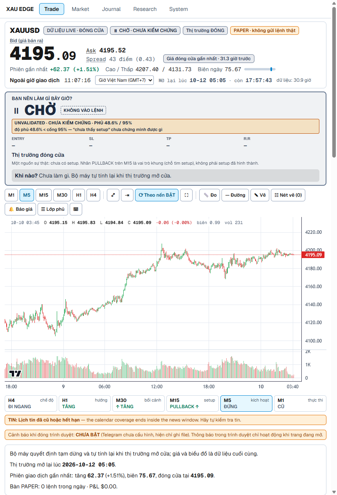

# XAU EDGE — Audit độc lập: vì sao chưa có bằng chứng Edge, và con đường ngắn nhất để kiểm chứng

Ngày: 2026-10-11 (GMT+7). Vai trò: Independent Quantitative Failure Analyst. Không bảo vệ thiết kế cũ.

**Nguồn sự thật.** Working tree local trên `03b7a0e` (Phase 2 chưa commit, đúng `PHASE2_COMPLETION_FINAL.md` §Verdict). Mọi số đo mới trong báo cáo này tái lập được bằng:

* `docs/reports/edge-audit-2026-10-11/analyze.py` → `measurements.json` (forward live, replay trades, hình học entry, độ sâu M1, power, tần suất);
* `docs/reports/edge-audit-2026-10-11/cost_regime.py` (spread/ATR theo năm);
* `docs/reports/edge-audit-2026-10-11/inventory.py` (kho dữ liệu).

Chạy: `.venv\Scripts\python.exe docs\reports\edge-audit-2026-10-11\analyze.py`. Các đo trên cửa sổ đã đốt là **Class D** (mô tả, không tính K, không tạo bằng chứng). Test-H và holdout **không bị chạm**.

Nhãn tin cậy: **HIGH** = code + số đo trực tiếp; **MEDIUM** = báo cáo có số + kiểm chéo một phần; **LOW** = suy luận hoặc mẫu rất nhỏ. Điều chưa chứng minh ghi **CHƯA XÁC MINH**.

---

## 1. Executive verdict

**XAU EDGE hiện là một terminal PAPER trung thực, chạy một baseline chỉ báo không có bằng chứng thống kê, với tần suất tín hiệu thấp đến mức không thể tự kiểm chứng.** (HIGH)

1. **Không có alpha được chứng minh ở bất kỳ họ nào đã thử** (V1 18 biến thể, V2 20 biến thể, 4 mô hình ML, baseline A/B/C, baseline MTF đang chạy). Đa số họ có **điểm ước lượng net âm với mẫu lớn**: đây là bằng chứng chống lại edge lớn, không chỉ "chưa đạt significance". (HIGH)
2. **Protocol không phải thứ giết ứng viên.** Không có biến thể nào net dương mà bị gate chặn. Ngoại lệ hẹp: H09 có gross dương nhỏ (+0.07R) bị chi phí ăn hết, đo trong kỷ nguyên mà chi phí tính theo ATR cao gấp 2–5 lần hiện nay. (MEDIUM)
3. **Human chủ yếu thấy CHỜ vì thiết kế, không phải bug.** Chuỗi đứt ở M15 setup (65% phút live) và ở hình học entry: chờ M5 xác nhận tiêu mất ~0.55 ATR(M15) theo hướng lệnh trước khi vào, rồi R/R ≥ 1.5 bị chặn bởi mức đối diện. (HIGH cho cơ chế, Class D)
4. **Baseline đang chạy không thể tự kiểm chứng.** 0.10–0.28 setup/ngày → 26–70 lệnh/năm → cần **3.7–10 năm** forward để phát hiện +0.20R. Khan hiếm tín hiệu tự nó là lỗi thiết kế. (HIGH)
5. **Forward F0 không mang thông tin.** Cửa sổ live chỉ có 477 phút thị trường mở; kể cả độ phủ 100% thì xác suất thấy 0 setup vẫn là 91–97%. (HIGH)
6. **Thiếu dữ liệu KHÔNG phải nút thắt chính.** Kho `data/market` có M1 từ 2004-06 (7.06 triệu nến) và tick bid/ask từ 2021-10. Báo cáo V2 nói "M1 INCONCLUSIVE" đã lỗi thời. Thiếu thật: lịch tin lịch sử, FX/XAG cùng broker chưa tải, DXY/lợi suất. (HIGH)

**Khuyến nghị gốc:** đóng băng UI và baseline MTF (chỉ sửa bug), dừng tinh chỉnh chỉ báo. Dồn 60 ngày tới vào 3 cơ chế mới có tần suất cao, được đăng ký trước, với mô hình chi phí theo kỷ nguyên đã xác minh bằng tick. Nếu không cơ chế nào sống qua Validation thì kết luận đúng là "không tìm thấy edge trong phạm vi khả thi" và dừng.

---

## 2. Product reality

| Thành phần | ENGINEERING COMPLETE | HUMAN-USABLE | STATISTICALLY VALIDATED | Bằng chứng |
|---|---|---|---|---|
| Data platform (MT5 → `data/market`) | CÓ | CÓ (độ mới hiển thị) | n/a | M1 2004-06..2026-10-09, tick 2021-10-01..2026-10-09 (`inventory.py`); Task Scheduler Ready (`PHASE2` §matrix) |
| Trading core (state → baseline) | CÓ | CÓ | **KHÔNG** | `trading/baseline.py:278-440`; nhãn `UNVALIDATED_BASELINE` `baseline.py:413` |
| TradingSignal v2 | CÓ | CÓ | n/a | `trading/schema.py` (v2 additive), goldens |
| ExecutionIntent | CÓ (paper / dry-run / funded disabled) | n/a | n/a | `trading/execution_intent.py` |
| PaperDesk | CÓ | CÓ | **KHÔNG** (0 lệnh live) | `paper_desk.py:534-575`; `paper_desk.json` live 313 B, 0 lệnh |
| Risk guards | CÓ | CÓ | n/a | `governor.py:22-32` (2%/3.5% ngày, 6 lệnh/ngày, cooldown 30′); `paper_desk.py:766-781` flatten |
| UI `/trade` | CÓ | CÓ (5 giây: CHỜ + lý do + coverage) | n/a | ảnh `img/edge-audit-2026-10-11/trade-live-closed-1440.png` |
| Forward evidence | Đo được (`coverage.py`) | Hiển thị trung thực | **F0, 48.64% < 95%** | `/trade/decision.forward_acceptance` đo 2026-10-11 |
| Legacy engine | Deprecated, còn importer runtime | Ẩn ở `/legacy` | n/a | `PHASE2` §LEGACY ENGINE PARTIAL |
| Demo | Dry-run adapter; cờ tắt | KHÔNG | KHÔNG | `config.py:37-39` (`enable_demo_trading=False`, `demo_dry_run=True`) |
| Funded | Khóa | KHÔNG | KHÔNG | `config.py:51,60` (`enable_funded_trading=False`, `funded_allow_unvalidated=False`) |
| **Edge** | — | — | **KHÔNG (0 survivor)** | V1 `final-verdict.md`; V2 `batch-a-stage1-report.md` |

Ba cột này **không được lấy trung bình**: kỹ thuật ~đủ, khả dụng cho người ~đủ, **thống kê = 0**. (HIGH)

---

## 3. UI page-by-page

Route thật (`apps/dashboard/app/**/page.tsx`): `/` → redirect `/trade`; `/trade`; `/market`; `/journal`; `/research` (+8 trang con); `/control`; `/legacy`. **Không có route `/system`**: menu "System" trỏ tới `/control` (`components/MainNav.tsx:11`). "Hệ thống" trong `/trade` là một tab (SystemCards).

| Trang | PURPOSE | PRIMARY USER | DECISION VALUE | CURRENT VALUE | MISSING VALUE | KHUYẾN NGHỊ |
|---|---|---|---|---|---|---|
| `/trade` | Quyết định ngay | Trader | Cao (nơi duy nhất ra quyết định) | Hành động, lý do, coverage, Entry/SL/TP/R:R, khi nào mở lại, MTF strip | Kỳ vọng lịch sử bằng số; TP2 hiển thị nhưng không được quản lý; "invalidation" hiển thị nhưng không hành động (mục 14) | **KEEP, đóng băng** trừ 2 sửa trung thực |
| `/market` | Theo dõi dữ liệu MT5 | Operator | Thấp | Trạng thái thành phần, báo giá, chart, ma trận độ mới khung (`MarketView.tsx:167-261`) | — | **MOVE** vào tab Hệ thống hoặc giữ như trang data-trust; REDUNDANT với `/trade` cho quyết định |
| `/journal` | Học từ lệnh | Trader + researcher | Trung bình (khi có lệnh) | R, MFE/MAE, thời lượng, lý do thoát, phiên, spread lúc vào, CSV (`JournalView.tsx:100,245-270`) | Chi phí tách theo R, trôi setup→trigger, nhãn H1/H4 trong CSV | **KEEP**, thêm tối thiểu (mục 3c) |
| `/research` | Bằng chứng edge | Owner / researcher | Cao cho quyết định nghiên cứu | 9 trang: overview, hypotheses, ledger, evidence, forward, data, lineage, candidates, operations | Một trang "vì sao chưa có edge / cái gì đã chết / test gì tiếp / K còn bao nhiêu" | **SIMPLIFY** overview theo 4 câu hỏi đó |
| `/control` ("System") | Vận hành bot DEMO | Operator | 0 cho trader | Preflight, chế độ, smoke DEMO, flatten khẩn cấp, nhật ký (`ControlPanel.tsx:334-455`) | — | **MOVE** khỏi menu chính khi DEMO khóa; đổi nhãn menu |
| `/legacy` | Dashboard cũ | Không ai | 0 | Banner deprecated | — | **REMOVE** khỏi điều hướng (đã ẩn) |

Trang giúp ra quyết định ngay: **chỉ `/trade`**. `/market` và tab Hệ thống là monitoring; `/research` là research; `/control` là operations; `/legacy` là debug/di sản. (HIGH)

Chấm theo OBSERVE / UNDERSTAND / DECIDE / PLAN / MANAGE / EXIT / REVIEW (không chấm trang trí chart):

| Trang | OBSERVE | UNDERSTAND | DECIDE | PLAN | MANAGE | EXIT | REVIEW |
|---|---|---|---|---|---|---|---|
| `/trade` | ✔ giá, phiên, dữ liệu | ✔ lý do CHỜ, bias ≠ lệnh | ✔ hành động duy nhất | ✔ Entry/SL/TP/R:R, rủi ro | ◐ GIỮ + thesis | ◐ quy tắc cơ học, TP2 gây hiểu nhầm | ✗ |
| `/market` | ✔ (trùng `/trade`) | ◐ độ mới khung | ✗ | ✗ | ✗ | ✗ | ✗ |
| `/journal` | ✗ | ◐ | ✗ | ✗ | ✗ | ✗ | ✔ (khi có lệnh) |
| `/research` | ✗ | ✔ "NO EDGE" | ✗ (đúng vai) | ✗ | ✗ | ✗ | ✔ nghiên cứu |
| `/control` | ✗ | ✗ | ✗ | ✗ | ✗ | ◐ flatten khẩn cấp (DEMO) | ◐ nhật ký thực thi |

### 3a. `/trade` — đủ thông tin quyết định chưa?

Ảnh LIVE (thị trường đóng, 2026-10-11 11:07 GMT+7):



| Câu hỏi | Có? | Ghi chú |
|---|---|---|
| Hành động hiện tại | **CÓ** | `CHỜ · KHÔNG VÀO LỆNH` |
| Vì sao | **CÓ** | "Thị trường đóng cửa"; khi mở: lý do chặn đầu tiên + "còn thiếu SETUP/TRIGGER" (`cockpit.py:242-247`) |
| Entry / SL / TP | **CÓ khi có tín hiệu** | "—" khi CHỜ (đúng); TP2 hiện nhưng không được thực thi |
| Rủi ro | **CÓ** | 0.25%/lệnh, lỗ ngày |
| Điều kiện tiếp theo | **MỘT PHẦN** | "khi nào mở lại" có; khi mở cửa chỉ nói SETUP/TRIGGER còn thiếu, không nói mức giá cần chạm (vùng EMA20 M15 ± band) |
| Trạng thái bằng chứng | **CÓ (nhãn)** / **THIẾU (số)** | `UNVALIDATED · phủ 48.6% / 95%`; không có kỳ vọng lịch sử bằng số (replay −0.41R n=11; Dev A −0.135R n=135) |

**Kết luận:** gần đủ. **Đóng băng UI trừ bug fix**, kèm 2 sửa trung thực (mục 28). Thông tin còn thiếu duy nhất có giá trị quyết định là **một dòng kỳ vọng lịch sử bằng số** cạnh nhãn UNVALIDATED. Đây là sửa trung thực, không phải feature. (HIGH)

### 3b. `/market` → **REDUNDANT** cho quyết định, **SUPPORTING** cho vận hành

Mọi thứ cần để quyết định (giá, spread, chart, MTF) đã có trên `/trade`. Giá trị riêng duy nhất là ma trận độ mới khung và trạng thái thành phần: đó là data-trust/ops, nên thuộc tab Hệ thống. (MEDIUM)

### 3c. `/journal` — schema có đủ để học khi có lệnh?

Backend record đã có: R, MFE/MAE (R), duration, exit_reason, setup_id, `planned_entry` vs `fill_price`, decision snapshot đầy đủ, market snapshot (H4/H1/M15/M5/M1, phiên, spread, vol) (`paper_desk.py:505-529`; journal mẫu `acceptance/*/paper_journal.jsonl`). **Thiếu (chỉ khi cần):**

1. Chi phí tách theo R (spread / slippage / swap) thay vì chỉ `net_pnl`.
2. Trôi setup→trigger (giá và thời gian từ ARMED tới TRIGGERED).
3. `planned_entry`, H1/H4/regime trong CSV export (`JournalView.tsx:100`).

Đủ cho học tập khi n lớn. Vấn đề là **n**, không phải schema. (HIGH)

### 3d. `/research` — nên dẫn dắt quyết định nghiên cứu

Hiện có đủ dữ liệu nội bộ (ledger, hypotheses, evidence, lineage…) nhưng overview nên trả lời đúng 4 câu theo thứ tự: **vì sao chưa có edge** (bảng mục 9), **đang ở pha nào** (V3 preregistration), **cái gì đã chết** (38 biến thể + ML + baselines, kèm loại thất bại), **test gì tiếp và K còn bao nhiêu**. Chỉ làm khi V3 bắt đầu. Không phải ưu tiên trước đó. (MEDIUM)

### 3e. `/system` và `/control` — bề mặt OPERATIONS

* Không có route `/system`. Menu "System" mở `/control` (bảng điều khiển bot DEMO: preflight, smoke, flatten). Khi DEMO khóa, trang này không có hành động hợp lệ cho trader và nhãn "System" gây hiểu nhầm.
* **Khuyến nghị:** đổi nhãn menu thành "Vận hành". **Ẩn `/control` khỏi menu chính khi `enable_demo_trading=False`** (truy cập bằng URL hoặc từ tab Hệ thống). Giữ nút flatten khẩn cấp cho lúc DEMO được bật. (MEDIUM)

---

## 4. Human value today

* **Hệ thống nói đúng baseline đang nói gì**: CHỜ, vì sao, dữ liệu có tin được không, thị trường mở hay đóng, độ phủ bằng chứng. Phần này làm tốt và trung thực (`DỮ LIỆU LIVE · ĐÓNG CỬA`, `UNVALIDATED · phủ 48.6% / 95%`). (HIGH)
* **Human không có lý do thống kê để tin baseline.** Không biến thể nào sống qua validation. Baseline MTF trên replay: 11 lệnh, win rate 18%, mean −0.41R, PF 0.47. Baseline A trên Dev 2025: n=135, net −0.135R (CI 95% [−0.359; +0.093]) (`CONSOLIDATION_AUDIT` §6). (HIGH)
* Giá trị thật hôm nay: **kỷ luật** (không vào lệnh bừa, sizing đúng, giới hạn lỗ ngày, nhật ký), **trung thực về dữ liệu**, và **hạ tầng đo** để kiểm chứng giả thuyết khác. Không phải dự báo. (HIGH)

---

## 5. Full decision chain (tái dựng từ code, v1.1.0 mặc định `baseline.py:49-50`)

| Bước | INPUT | RULE (file:line) | OUTPUT | BLOCKER | FAILURE POSSIBILITY |
|---|---|---|---|---|---|
| DATA | Nến MT5 M1..H4, quote, spread | collector → `data/market`; `live_source.py`; stale = 3 nến (`market_state.py:51`) | Snapshot | STALE_DATA, MARKET_CLOSED, UNKNOWN_STATE (`baseline.py:233-243`) | Downtime collector → độ phủ 48.6% |
| FEATURE | OHLC, tick volume | EMA20/50, ATR14, ATR percentile 200, swing 3/3, BOS 6, RSI14, ROC, vol z (`market_state.py:42-57,195`) | `TfSnapshot` | — | ~16 tham số state + 10 baseline + 8 level: nhiều bậc tự do |
| MARKET STATE | Snapshot | nhãn cấu trúc, CHoCH (`market_state.py:311-317`) | nhãn | — | Nhãn tương đối, không phải cơ chế |
| REGIME | H4 | chặn SHOCK/HIGH_VOL (`baseline.py:86,267-268`); H4 ngược chặn (`baseline.py:54,309-313`) | veto | VOLATILITY_TOO_HIGH, TIMEFRAME_CONFLICT | H4 không tạo lệnh, chỉ chặn |
| DIRECTION | H1 | `close>EMA50 & EMA20>EMA50 & structure≥0` (`market_state.py:301-308`; `baseline.py:301-307`) | BUY/SELL bias | NO_DIRECTION | V1 H04 (xu hướng + hồi EMA) là họ âm nhất (mục 8) |
| SETUP | M15 | cấu trúc cùng hướng + giá trong [−0.3; +0.7] ATR quanh EMA20 (`market_state.py:319-327`; `baseline.py:315-323`) | setup | NO_SETUP, TIMEFRAME_CONFLICT | 65% phút live dừng ở đây |
| TRIGGER | M5 | ROC>0 & RSI>52 & (BOS hoặc thân mạnh), hoặc BOS+ROC (`market_state.py:330-342`; `baseline.py:325-326`) | trigger | NO_TRIGGER | Trigger động lượng tự nó kéo giá rời vùng pullback (mục 13) |
| EXECUTION FILTER | M1, spread, vol percentile | `m1_execution_state` (`baseline.py:114-131,327-347`); spread POOR / vol LOW/HIGH (`baseline.py:252-266`; percentile 0.2/0.8 `market_state.py:56-57`) | chặn | VOLUME_TOO_LOW, SPREAD_TOO_WIDE, VOLATILITY_* | Nhãn vol tương đối gần ngẫu nhiên so với tuyệt đối (`SIGNAL_FUNNEL_ANALYSIS` §7) |
| ENTRY GEOMETRY | quote | MARKET tại ask/bid (`baseline.py:358-364`); phòng tới mức đối diện ≥ 1 ATR(M15) (`baseline.py:349-356`) | entry | TOO_CLOSE_TO_RESISTANCE/SUPPORT | Vào muộn sau trigger |
| SL / TP | swing M5, ATR(M15) | SL HYBRID = max(swing+0.1ATR, 1.25ATR), ≤ 3ATR (`levels.py:63-86`); TP = 2R, cắt ở mức đối diện −0.1ATR; TP2 = 3R chỉ khi không bị cắt (`levels.py:89-128`) | SL, TP1, (TP2) | INVALID_STOP_DISTANCE | Stop thang M15, trigger thang M5 (`SIGNAL_FUNNEL_ANALYSIS` §6) |
| RR / COST | spread | `net_rr=(reward−spread)/(risk+spread) ≥ 1.5` (`levels.py:100-117`); slippage chỉ ở fill (`paper_desk.py:539-540`) | net R:R | RR_TOO_LOW | Chặn 91% tập setup+trigger |
| EVIDENCE / GUARDS | account, desk | news UNKNOWN chỉ cảnh báo trên paper (`engine.py:82`, `baseline.py:247-251`); cooldown/daily/risk (`baseline.py:269-274`); governor (`governor.py:22-32`) | cho phép / chặn | DAILY_LIMIT, RISK_LIMIT, COOLDOWN | Lịch tin chỉ có 1 tuần (`data/news/calendar.csv`, 24 sự kiện) |
| TRADING SIGNAL | tất cả trên | `TradingSignal` v2, `UNVALIDATED_BASELINE` (`baseline.py:395-440`) | BUY/SELL/WAIT | — | — |
| EXECUTION INTENT | signal | `intent_from_signal` (`execution_intent.py`) | intent | — | Demo vẫn không dùng engine này ở runtime (`PHASE2` §DEMO) |
| PAPER POSITION | intent + quote | fill tại ask/bid ± slip; hủy nếu trôi > 0.25R (`paper_desk.py:137,539-544`); `tp = decision.take_profit` (`paper_desk.py:518`) | vị thế 1 TP | ENTRY_DRIFT, governor | TP2 bị bỏ |
| HOLD / EXIT | nến M1 | `evaluate` (`position_manager.py:136-183`) với desk config `close_on_invalidation=False` (`paper_desk.py:139-143`); time exit 120′ (`paper_desk.py:136,553`) | HOLD/CLOSE | — | Không BE, không trail, không partial |
| UI | API | `next_action` (`cockpit.py:189-249`); `DecisionPanel.tsx:135-139` | CHỜ/MUA/BÁN/GIỮ/THOÁT | — | TP2 hiển thị dù không quản lý |

---

## 6. Failure tree

```
NO ACTIONABLE SIGNAL
├── SIGNAL SCARCITY ............................................ HIGH
│   ├── regime filter      — CHỐNG: gỡ mọi cổng ngữ cảnh chỉ 2 → 10 tín hiệu (SIGNAL_FUNNEL §3)
│   ├── setup rarity       — ỦNG HỘ: 65% phút live dừng ở NO_SETUP; M15 setup 11.6% nến (§2)
│   ├── trigger rarity     — TRUNG TÍNH: 67% setup có trigger trong ≤12 nến M5 (đo mới)
│   └── excessive veto     — MỘT PHẦN: vol/spread che 55% trạng thái nhưng ít ảnh hưởng tín hiệu
├── BAD ENTRY GEOMETRY ......................................... HIGH
│   ├── late trigger       — ỦNG HỘ: trôi +0.55 ATR(M15) trung vị trước entry; ~75% move 2h xảy ra trước entry
│   ├── wide SL            — MỘT PHẦN: stop trung vị 1.47 ATR(M15), sàn 1.25 ràng buộc 53/156
│   ├── target too close   — ỦNG HỘ: phòng trung vị 1.15 ATR vs cần 2.21; 90% thiếu
│   └── RR rejection       — ỦNG HỘ: RR qua 11/156 (7%) tại setup+trigger
├── NO PREDICTIVE EDGE ......................................... HIGH (cho họ đã thử)
│   ├── features non-predictive — ỦNG HỘ: ML không thắng base rate OOS (model-evaluation.md)
│   ├── pattern hypothesis weak — ỦNG HỘ: H04 trend+pullback âm −0.12..−0.19R, n 690–1860
│   └── regime instability      — CHƯA XÁC MINH (kỷ nguyên trước/sau 2021 chưa so trên Test-H)
├── EDGE TOO THIN .............................................. MEDIUM, hẹp
│   ├── spread             — ỦNG HỘ cho H09/H10 (gross +0.01..+0.07R, chi phí ~0.10–0.12R ở 2011–18)
│   │                        CHỐNG cho baseline live: drag spread đo 0.048R/lệnh
│   ├── slippage           — 3/6 points giả định, CHƯA XÁC MINH bằng fill thật
│   ├── commission         — 0, CHƯA XÁC MINH (final-verdict.md §Giới hạn)
│   └── swap               — 0.01–0.03R (00-forensics §3), nhỏ
├── STATISTICAL POWER FAILURE .................................. HIGH (cho baseline live), MEDIUM (H03/H06)
│   ├── sample too small   — replay 11 lệnh (MDE ~1R); Dev A n=135 (MDE ~0.28R)
│   ├── low signal frequency — 26–70 lệnh/năm
│   └── multiple-testing penalty — K_tổng ≥ 41 cho V2; +0.10R cần 2,250–2,535 lệnh
└── OPERATIONS FAILURE ......................................... HIGH (cho forward), không phải gốc của CHỜ
    ├── missing decisions  — 245/477 phút thiếu, khoảng 30′ + 215′
    ├── coverage           — 48.64% < 95%
    └── uptime             — Task Scheduler Ready; downtime trước đó là gốc (CONSOLIDATION §7)
```

---

## 7. Where the signal chain breaks

**Funnel live (forward, 2026-10-09 12:53Z → 2026-10-11, 259 dòng quyết định, 234 khi thị trường mở)** — lý do chặn đầu tiên:

| Lý do | Số phút | % phút mở |
|---|---:|---:|
| NO_SETUP | 151 | 64.5% |
| TIMEFRAME_CONFLICT (M15 ngược H1) | 35 | 15.0% |
| NO_TRIGGER | 35 | 15.0% |
| TOO_CLOSE_TO_RESISTANCE | 8 | 3.4% |
| SPREAD_TOO_WIDE | 2 | 0.9% |
| VOLUME_TOO_LOW | 2 | 0.9% |
| STALE_DATA | 1 | 0.4% |

Ngữ cảnh khi mở cửa: H1 **BULLISH 100%**, H4 RANGE 100%, volatility NORMAL 100%, news UNKNOWN 100%, M1 QUIET 26%. (HIGH, nguồn `data/trade/decisions-2026101*.jsonl`)

**Funnel replay (3 cửa sổ đã đốt, 16,270 quyết định, `SIGNAL_FUNNEL_ANALYSIS` §2):** 16,270 → spread 14,334 → vol 7,385 → H4 6,369 → H1 có hướng 4,912 → M15 không ngược 3,976 → **setup 573** → **trigger 53** → M1 45 → clearance 23 → **RR 2**.

Trả lời A–M:

| | Có phải lý do? | Bằng chứng | Tin cậy |
|---|---|---|---|
| A. không có direction | **KHÔNG** (live) | H1 có hướng 100% phút mở | HIGH |
| B. không có setup | **CÓ — lý do số 1** | 64.5% live; setup 11.6% nến replay | HIGH |
| C. setup có nhưng không trigger | Một phần | 15% live; 67% setup có trigger ≤ 1 giờ | HIGH |
| D. trigger quá muộn | **CÓ — lý do cấu trúc** | trôi +0.55 ATR trước entry → RR fail | HIGH (Class D) |
| E. M1 veto | Nhỏ | gỡ M1 quiet không thêm tín hiệu (§8 funnel) | HIGH |
| F. spread | Nhỏ | 0.9% live; gỡ veto spread 2 → 2 | HIGH |
| G. volatility | Nhỏ (live 0%) | gỡ cả hai cổng vol 2 → 7 | HIGH |
| H. structure room | **CÓ** | 3.4% live chạm cổng này; replay clearance 45 → 23 | HIGH |
| I. RR | **CÓ — kẻ giết cuối** | 23 → 2 | HIGH |
| J. news | KHÔNG (paper chỉ cảnh báo) | `engine.py:82` | HIGH |
| K. risk guard | KHÔNG | 0 lần chặn live | HIGH |
| L. data | KHÔNG cho CHỜ | 1 phút STALE | HIGH |
| M. uptime | KHÔNG cho CHỜ; CÓ cho forward | coverage 48.6% | HIGH |

---

## 8. Edge Program autopsy

### V1 (Programme 1, 2026-10-08) — `docs/research/edge-program/ledger.md`

* 6 giả thuyết × 3 = 18 biến thể + 3 baseline → **K = 21**, α = 0.0024. Dev-H 2011–2018, Val-H 2019–2021. Barrier H1 cố định theo ATR. Chi phí: spread max(ghi nhận, 30 pts), slip 3/6 pts, swap hiện hành, commission 0.
* 36 lần chạy. **3/36 có mean net R cơ sở > 0** (H03-c0.9 Val +0.021 n=83; H03-c1.0 Dev +0.0001; H05-s2.5 Val +0.667 n=6). **PF cơ sở cao nhất 1.023.** Maximin tốt nhất (≥100 lệnh cả hai) H03-c1.0 = **−0.066R**. Drawdown: CHƯA XÁC MINH trong ledger (có trong `experiments/edge_program/*.json`).
* Test-H: **không chạy**. Holdout: **không chạm**. Survivor: **0**.

| Họ | n (Dev/Val) | Mean net R bi quan (Dev/Val) | Cái gì chết |
|---|---|---|---|
| H01 động lượng giờ mở phiên | 729–2727 / 291–1091 | −0.09..−0.12 / −0.05..−0.12 | Hướng: âm mọi biến thể, mẫu lớn |
| H02 phá biên Asia | 1320–1714 / 487–640 | −0.07..−0.10 / −0.04..−0.10 | Hướng |
| H03 nén → mở rộng | 83–211 / 35–119 | −0.01..−0.09 / −0.07..+0.01 | Mẫu nhỏ, không ổn định dấu |
| H04 xu hướng ngày + hồi EMA | 1810–1861 / 687–703 | −0.14..−0.20 / −0.13..−0.17 | **Hướng, âm mạnh nhất** (= cơ chế của baseline live) |
| H05 fade bar xung lực | 22–815 / 6–305 | −0.13..−0.35 / −0.05..+0.67(n=6) | Hướng (s1.5), mẫu nhỏ (s2.5) |
| H06 Donchian H4 | 78–142 / 34–71 | −0.04..−0.18 / −0.27..−0.43 | Mẫu nhỏ, điểm ước lượng âm mạnh |

### V2 Batch A (2026-10-09) — `edge-program-v2/ledger.md`, `batch-a-stage1-report.md`, `cost-attribution-dev2.json`

* 4 giả thuyết, 20 biến thể (4 bị loại vì underpowered-by-design), **K = 20, trần 24**; Stage 2 bắt buộc dùng K_tổng = 41. Chỉ Dev-2 2011–2018 (đã bị V1 dùng). Holm FW 0.10.
* **0/20 sống sót.** Mean net bi quan âm cả 20. Test-H, holdout không chạm.

| Họ | n | Gross-mid | Net bi quan | p (một phía) | Cái gì chết |
|---|---|---|---|---|---|
| H07 quét thanh khoản rồi đảo chiều (PD) | 1404–1608 | −0.60..−0.62 | −0.71..−0.73 | 1.00 | Hướng (gross âm rất mạnh) |
| H07 (ASIA) | 1324–2142 | −0.14..−0.17 | −0.30..−0.33 | 1.00 | Hướng |
| H08 chấp nhận phá vỡ | 640–777 | −0.06..−0.07 | −0.23..−0.24 | 1.00 | Hướng + chi phí |
| H09 chuyển phiên Asia→London | 752–1598 | **+0.065..+0.074** | −0.07..−0.08 | 0.84–0.94 | **Chi phí** (CI net t0.2 [−0.155; +0.049]) |
| H09 London→NY | 625–1497 | −0.02..+0.03 | −0.12..−0.18 | ≥ 0.995 | Hướng + chi phí |
| H10 giãn nở vol có điều kiện | 661–1230 | −0.14..+0.025 | −0.15..−0.31 | ≥ 0.99 | Gross ≈ 0, chi phí |

* Class D: mirror của H07-PD (tiếp diễn theo chiều quét) +0.48R; 85% sự kiện ở 21–23 UTC (rollover). Reviewer độc lập coi là **nghi artefact** cho tới khi kiểm bằng M1/tick (`batch-a-stage1-report.md` §Class D). **Chưa kiểm** dù M1/tick nay đã có.

### Các họ khác

* ML (logistic, RF, XGBoost, LightGBM; K = 7→10): logistic Dev PF 1.14, +19% → Val PF 0.81, −13.7%; **không mô hình nào thắng base rate OOS** (`model-evaluation.md` §Results, §Conclusion). (MEDIUM)
* Baseline A/B/C: FAIL E1. Baseline A Dev 2025 n=135: gross −0.054R [−0.279; +0.175], net −0.135R (`CONSOLIDATION_AUDIT` §6). (MEDIUM)
* Baseline MTF v1.1/v1.2: v1.2 bị loại theo tiêu chí tần suất đã đăng ký (0.167 < 0.25/ngày); replay 11 lệnh −4.53R tổng (đo mới). (HIGH)
* Analogue/pattern similarity: 4 lần chạy / 2 tên (`00-forensics.md` §5); kết luận edge: **CHƯA XÁC MINH** trong báo cáo này.

---

## 9. Protocol vs alpha failure

**Kết luận chung: A (không có alpha có ý nghĩa) chiếm đa số. B (alpha yếu nhưng protocol đòi nhiều hơn) chỉ áp dụng hẹp cho H09. C (mẫu không đủ để phân biệt) áp dụng cho H03, H06, baseline live.** (MEDIUM-HIGH)

| Họ | Phân loại | Lý do | Tin cậy |
|---|---|---|---|
| H01, H02, H04, H07 | **NO ALPHA EVIDENCE** | Gross/net âm, n lớn, MDE 0.06–0.15R: loại trừ được edge ≥ ~0.15R | HIGH |
| H05 (s1.5) | NO ALPHA EVIDENCE | n 815/305 âm | HIGH |
| H05 (s2.0, s2.5), H03, H06 | **SAMPLE UNDERPOWERED** | n 6–211; MDE 0.33–1R | MEDIUM |
| H08 | NO ALPHA EVIDENCE | gross âm | MEDIUM-HIGH |
| H09 Asia→London | **GROSS EDGE BUT COST-KILLED** (gross cũng chưa có ý nghĩa sau K) | gross +0.07R, SE ~0.03–0.05; net âm; đo ở kỷ nguyên chi phí/ATR 0.05–0.11R | MEDIUM |
| H10 L50/L100 | WEAK / INCONCLUSIVE → thực chất không alpha | gross +0.01..+0.025R | MEDIUM |
| ML models | **VALIDATION FAILURE** | Dev đẹp, Val âm | MEDIUM |
| Baseline A / MTF live | SAMPLE UNDERPOWERED, điểm ước lượng âm | n=135 / 11 | HIGH |

**Phát hiện protocol mới (đo, Class D, không cứu biến thể nào):** chi phí tính bằng R đổi theo kỷ nguyên mạnh hơn mức protocol giả định (`cost_regime.py`, spread nến MT5):

| Năm | Giá | ATR(H1) | Spread trung vị (pts) | spread/ATR(H1) ghi nhận | với sàn 30 pts |
|---|---:|---:|---:|---:|---:|
| 2011 | 1547 | 4.68 | 55 | 0.112 | 0.114 |
| 2015 | 1167 | 3.48 | 34 | 0.099 | 0.104 |
| 2018 | 1262 | 2.77 | 15 | 0.058 | 0.110 |
| 2022 | 1805 | 4.48 | 7 | 0.016 | 0.067 |
| 2024 | 2381 | 5.77 | 15 | 0.024 | 0.052 |
| 2025 | 3345 | 9.96 | 21 | 0.022 | 0.030 |
| 2026 | 4501 | 19.16 | 40 | 0.021 | 0.021 |

Nghĩa là "edge H1 phải vượt rõ 0.10R" (`00-forensics.md` §3) **chỉ đúng cho 2011–2019**. Ở chế độ giá hiện tại, chi phí spread ~0.02–0.03R/lệnh ở thang ATR H1. Nghĩa của "spread" trên nến MT5 (min hay tại open) là **CHƯA XÁC MINH**; tick bid/ask 2021-10+ cho phép xác minh. Đây là lỗi **mô hình chi phí**, không phải bằng chứng alpha. Nó không được dùng để mở lại H09 (đó là retune trên Dev đã đốt). Nó phải được sửa **trước** V3.

---

## 10. Statistical power

Công thức: n = ((z₁₋α/K + z₀.₈) · σ / δ)², một phía, Bonferroni. σ của R với barrier −1R/+2R ≈ 1.3 (giả định của chính chương trình, `H09.md` §công suất).

**Số lệnh cần để phát hiện δ (σ = 1.3, power 0.8):**

| δ | K = 1 | K = 20 | K = 41 |
|---|---:|---:|---:|
| +0.05R | 4,180 | 9,000 | 10,138 |
| +0.10R | 1,045 | 2,250 | 2,535 |
| +0.15R | 465 | 1,000 | 1,127 |
| +0.20R | 262 | 563 | 634 |

**MDE đã đạt (σ = 1.3):** n=11 → 0.98R; n=135 → 0.28R; n=211 (H03) → 0.33R tại K=20; n=752 → 0.17R; n=1,598 → 0.12R; n=2,727 → 0.09R tại K=20.

Đọc đúng:

* Họ có n ≥ 1,000 (H01, H02, H04, H07, H09-t0.4) **đã loại trừ edge ≥ ~0.12–0.15R**. Đây là "bằng chứng vắng mặt edge lớn", không chỉ là "fail significance". (HIGH)
* **Không thiết kế nào trong repo phát hiện được +0.05R.** Với một giả thuyết 1 sự kiện/ngày, 15 năm dữ liệu ≈ 3,750 sự kiện, vẫn dưới mức cần ở K ≥ 20. +0.05R cũng không có giá trị kinh tế: ở rủi ro 0.25% và 50 lệnh/năm, nó chỉ là ~0.6%/năm. **Mục tiêu nghiên cứu hợp lý: δ ≥ +0.15R với ≥ 150 sự kiện/năm.** (HIGH)
* H03, H06, baseline A, baseline live: **thất bại significance ≠ chứng minh không có edge**. Chúng chỉ chưa đủ mẫu để nói. (HIGH)

---

## 11. Signal frequency (baseline MTF live)

| Đại lượng | Giá trị | Nguồn |
|---|---|---|
| Setup episode M15 | ~3.1/ngày (184 / ~59 ngày) | đo mới, 3 cửa sổ funnel |
| Triggered (≤ 12 nến M5) | ~2.1/ngày (123) | đo mới |
| Tín hiệu hành động v1.1 | 0.034/ngày (2 / 59 ngày); 0.104–0.128/ngày ở E1/E2 | `SIGNAL_FUNNEL` §1, §10.4 |
| Tín hiệu v1.2.x | 0.167–0.205/ngày (Poisson 95% 0.09–0.40) | `SIGNAL_FUNNEL` §10.4 |
| Lệnh/tháng | 2.2–5.9 | 21 ngày/tháng |
| Lệnh/năm | 26–70 | 250 ngày |

**Kiểm chứng trong 3 / 6 / 12 tháng?** Lần lượt 6–18 / 13–36 / 26–71 lệnh. MDE ở n=26 là 0.63R và ở n=71 là 0.38R (K=1). Phát hiện +0.20R cần 3.7–10 năm; +0.10R cần 15–40 năm. **KHÔNG.** Forward trên baseline này chỉ kiểm được **tính đúng vận hành**, không bao giờ kiểm được edge. Khan hiếm tín hiệu là **lỗi thiết kế**: lọc 3 setup/ngày xuống 0.03–0.2 lệnh/ngày bằng các cổng hình học. (HIGH)

---

## 12. Expectancy decomposition

**Replay vòng đời paper (11 lệnh, 3 cửa sổ đã đốt, đã trừ chi phí; thăm dò, không phải bằng chứng):**

| Chỉ số | Giá trị |
|---|---|
| Win rate | 18.2% (2/11), cần ≥ 37.6% cho net R:R 1.66 |
| Avg win / avg loss | +1.99R / −0.94R |
| Mean R / median R | **−0.41R** / −1.01R |
| PF | 0.47 |
| MFE / MAE trung bình | 0.80R / 0.87R; 27% lệnh có MFE ≥ 1R |
| Thời lượng trung bình | 65 phút (time exit 120′) |
| Thoát | SL 8, TP 2, TIME 1 |
| Spread drag | **0.048R/lệnh** (đo từ journal) |
| Slippage / swap / commission | 1 pt mỗi lần khớp (paper broker) / 0 (intraday) / 0, **CHƯA XÁC MINH** với broker |

**Dev 2025 Baseline A (n=135):** gross −0.054R, net −0.135R; chi phí 0.059 spread + 0.012 slip + 0.009 swap; WR 31.1%; SL 68% / TP 27% / TIME 4.4%; give-back khớp random walk (`CONSOLIDATION` §6).

**Lỗ đến từ đâu?**

* **Direction / entry:** CÓ. Gross đã âm hoặc ≈ 0 trước chi phí (A gross −0.054R; V1 H04 âm mạnh). (MEDIUM-HIGH)
* **Cost:** KHÔNG là gốc của baseline live (0.048R). LÀ gốc cho H09/H10 ở 2011–2018. (HIGH)
* **Stop / target:** Hình học −1R/+2R với WR ~18–31% đúng là kết quả của random walk. 3/11 lệnh đạt MFE 0.82–1.84R rồi bị stop. **Không được chỉnh BE/TP theo 11 lệnh** (post-hoc). (LOW)
* **Exit:** chưa có logic quản lý nào được kiểm (mục 14). (HIGH)

---

## 13. Entry geometry (M15 setup → M5 trigger)

Đo mới (Class D, 3 cửa sổ funnel đã đốt; giá đóng M5 từ `data/market`; ATR = ATR(M15) tại nến setup; hướng = H1):

| Đại lượng | Giá trị |
|---|---|
| Setup episode | 184; có trigger trong ≤ 12 nến M5: 123 (67%) |
| Trễ setup → trigger | trung vị **5 nến M5 (25′)**, trung bình 5.7 |
| Trôi giá setup → trigger (theo hướng lệnh) | trung vị **+0.55 ATR(M15)** (IQR +0.32..+0.78), trung bình +0.58 |
| MFE trước trigger | +0.49 ATR |
| Forward 2h sau trigger | +0.19 ATR (n=123) |
| ⇒ phần move (setup → trigger+2h) xảy ra **trước** entry | ~75% (0.58 / 0.77) |
| Stop trung vị tại setup+trigger | 1.47 ATR(M15) (`SIGNAL_FUNNEL` §6) ⇒ trôi tiêu ~0.37R khoảng cách stop |
| Phòng tới mức đối diện | trung vị 1.15 ATR, cần 2.21 cho net RR 1.5; 90% thiếu |
| Gross RR / net RR | lệnh mẫu: gross 1.76, net 1.66, capped_by_structure = True |

**Có. Chờ xác nhận tiêu hao phần thưởng một cách hệ thống.** Trigger động lượng (ROC>0, RSI>52, BOS) theo định nghĩa đòi giá đã đi theo hướng lệnh. Entry vì thế dời 0.55 ATR về phía mức đối diện, trong khi stop vẫn neo theo thang M15. R/R ≥ 1.5 trở nên bất khả ở 90% trường hợp. Đây là mâu thuẫn **thiết kế**, không phải ngưỡng sai. Lưu ý: trôi dương một phần là **cơ học** (do định nghĩa trigger), đó chính là vấn đề. Forward +0.19 ATR sau trigger là nhiễu trên dữ liệu đã đốt, **không phải** dấu hiệu edge. (HIGH cho cơ chế, LOW cho mọi suy diễn lợi nhuận)

---

## 14. Exit / take-profit

| Cơ chế | Trạng thái | Bằng chứng |
|---|---|---|
| SL | **ACTIVE** | `position_manager.py:147-152` (stop trước target trong cùng nến) |
| TP1 | **ACTIVE** | `paper_desk.py:518` `tp = decision.take_profit` |
| TP2 | **MISSING trong thực thi** (tính và **hiển thị**, không quản lý) | `levels.py:118-120`; `DecisionPanel.tsx:137`; desk chỉ có một `tp` |
| TIME EXIT | **ACTIVE** 120′ | `paper_desk.py:136,553`; manager tắt riêng (`NO_TIME_EXIT` `:50-51`) |
| INVALIDATION | **DISABLED** (chỉ hiện "thesis INTACT/WEAK") | `paper_desk.py:139-143`; `cockpit.py:200-203,222-226` |
| FORCED FLAT | **DISABLED trong manager**; đóng cửa xử lý bằng policy `BLOCK_NEW_NEAR_CLOSE` | `must_flat_by` không được truyền (`paper_desk.py:768-781`); `paper_desk.py:145,400-410` |
| DAILY LOSS | **ACTIVE** (flatten 3.5%, chặn mở 2%) | `governor.py:30-32,79,93`; `paper_desk.py:766-781` |
| BREAK EVEN | **DISABLED** | `position_manager.py:56` |
| TRAIL | **DISABLED** | `position_manager.py:60` |
| PARTIAL CLOSE | **MISSING** | không có mã |

**Human có biết khi nào chốt lời / giữ / cắt lỗ không?** Biết *quy tắc cơ học* (TP1, SL, 120′, lỗ ngày). **Không** có logic quản lý nào đã được kiểm chứng: TP 2R không có cơ sở thống kê, và BE/trail tắt đúng như phải thế khi chưa có bằng chứng. Có hai **mâu thuẫn trung thực** nên sửa:

1. UI hiện "TP 2" nhưng desk không bao giờ chốt ở TP2.
2. Signal ghi "invalidation: H1 turns bearish" nhưng desk không đóng lệnh khi điều đó xảy ra.

Code tồn tại ≠ logic quản lý được kiểm chứng. (HIGH)

---

## 15. Data adequacy

| Loại | Có? | Độ sâu / ghi chú |
|---|---|---|
| Bars M1..H4 | **CÓ** | `data/market`: M1 7.06M nến 2004-06..2026-10-09 (~350k/năm từ 2012); H1/H4 từ 2004 |
| Ticks bid/ask | **CÓ** | 1,563 ngày 2021-10-01..2026-10-09 (`bid, ask, last, volume, flags`) |
| Spread | Một phần | trên nến từ 2011 (2004–2010 = 0; 2021 trung vị 0, đáng ngờ); tick 2021+ |
| Tick volume | CÓ | không phải volume sàn |
| News | **KHÔNG (lịch sử)** | `data/news/calendar.csv` chỉ 24 sự kiện tuần này |
| Session | CÓ (tính) | đồng hồ broker **chưa chứng nhận 2010–2020** (`00-forensics.md` §1) |
| Broker specs | CÓ (live) | commission 0 **CHƯA XÁC MINH** |
| External macro (DXY, US10Y, GC, COT, IV) | **KHÔNG** | broker không có DXY/chỉ số/dầu (`00-forensics.md` §4) |
| FX/XAG cùng broker | Có trên terminal, **chưa tải** | XAGUSD, EURUSD, USDJPY… (`00-forensics.md` §4) |

**Thiếu dữ liệu có thật sự chặn khám phá edge? PARTLY.** Với các họ đã thử (giá XAU thuần), dữ liệu đã thừa đủ: thêm dữ liệu sẽ không cứu H01–H10. Dữ liệu **chỉ chặn** đúng các họ chưa thử: event-driven (cần lịch tin lịch sử), cross-market (cần FX/XAG M1 cùng broker, tải được ngay), macro (cần nguồn ngoài). Báo cáo V2 "M1 INCONCLUSIVE / tick từ 2022" **đã lỗi thời**: kho hiện có M1 từ 2004 và tick từ 2021-10. (HIGH)

---

### 15b. Data value hierarchy (chỉ khi có giả thuyết)

| Dữ liệu | Cơ chế kinh tế | Giá trị cho Human | Alpha potential (H1–intraday) | Latency | Lịch sử | Chi phí | Độ phức tạp | Rủi ro overfit | Kết luận |
|---|---|---|---|---|---|---|---|---|---|
| EURUSD/USDJPY M1 (proxy USD, cùng broker) | Vàng định giá bằng USD; tách phần do USD và phần riêng của vàng | Cao (biết move do USD hay do vàng) | **Trung bình–cao** | ~0 | MT5, CHƯA XÁC MINH độ sâu | 0 | Thấp | Thấp–TB | **ƯU TIÊN 1** (giả thuyết F1) |
| XAGUSD M1 (cùng broker) | Đồng chuyển động kim loại; lệch tỷ lệ = dòng riêng | TB | TB | ~0 | MT5 | 0 | Thấp | TB | Ưu tiên 2 (kèm F1) |
| Lịch tin vĩ mô lịch sử (giờ đã lên lịch) | Cú sốc thông tin theo lịch | **Rất cao** (tránh / chờ tin) | TB | lịch biết trước | ForexFactory lịch sử (owner) | thấp | TB | TB | **ƯU TIÊN 1** (F2) |
| DXY | Như EURUSD nhưng rổ | TB | Thấp hơn EURUSD+USDJPY về biên | phụ thuộc nguồn | nguồn ngoài | $ | TB | TB | Không cần nếu có FX |
| US10Y / real yields | Chi phí cơ hội của vàng | Cao (ngữ cảnh ngày) | **Thấp ở intraday**, TB ở daily | ngày/phút tuỳ nguồn | FRED (ngày) | 0–$ | TB | Cao (ít điểm độc lập) | Hoãn; chỉ làm bộ lọc daily sau khi có giả thuyết |
| COMEX GC giá/volume | Khám phá giá ở futures; volume thật | TB | TB (futures/spot gap) | phút ($) | trả phí | $$ | Cao | TB | Hoãn |
| Open interest / COT | Định vị đầu cơ | Thấp intraday | Thấp (tuần, trễ 3 ngày) | tuần | CFTC | 0 | Thấp | Cao | Không |
| Options IV (GVZ) | Kỳ vọng biến động | TB (cảnh báo) | Thấp hướng, TB cho vol | ngày | CBOE | 0–$ | TB | TB | Không cho hướng |

---

## 16. Hypothesis quality (các họ đã thử)

| Họ | Lý do kinh tế | Lý do vi cấu trúc | Nhân quả | Tham số | Tần suất | Ổn định regime | Nhạy chi phí |
|---|---|---|---|---|---|---|---|
| H01 / H02 / H09 (phiên) | Yếu–TB | TB | Thấp | 1–2 | 1/ngày | Đồng hồ đổi 2021 | Cao |
| H03 / H10 (nén → giãn) | TB (vol clustering là thật, nhưng **không cho hướng**) | Thấp | Thấp cho hướng | 1–2 | thấp | — | Cao |
| H04 (trend + pullback) | Yếu ở H1 | Thấp | Thấp | 1 | cao | — | TB |
| H05 (fade xung lực) | TB (price impact tạm thời) | TB | TB | 1 | TB | — | Cao |
| H06 (Donchian H4) | TB ở daily+, yếu ở H4 | Thấp | Thấp | 1 | thấp | — | Thấp |
| H07 / H08 (quét / chấp nhận) | Yếu ("stop hunt" là truyện kể) | TB | Thấp | 1 | TB | — | TB |
| ML (TA features) | Không | Không | Không | nhiều | — | — | — |
| Baseline MTF live | Không (chuỗi chỉ báo) | Không | Không | **~35+** (state 16, baseline 10, levels 8, pullback band, RSI 52/48, vol z) | 0.1–0.3/ngày | — | TB |

**Kết luận:** nghiên cứu đến nay **chủ yếu kiểm tổ hợp chỉ báo trên một chuỗi giá duy nhất** (XAU OHLC). V1/V2 có kỷ luật đăng ký trước tốt, nhưng mọi họ đều là biến đổi của: phiên × biên độ × ATR × xu hướng EMA/SMA. **Không họ nào dùng thông tin ngoài giá XAU** (USD, lịch tin, tài sản liên quan), tức là chưa từng kiểm một cơ chế có nguồn thông tin độc lập. (HIGH)

---

## 17. New mechanism families (tối đa 5, không phải biến thể tham số của họ đã chết)

### F1. Phần chuyển động "riêng của vàng" sau khi loại USD (cross-market, đảo chiều)

* **Mechanism:** chuyển động XAUUSD theo giờ = phần USD (đồng pha với EURUSD/USDJPY) + phần riêng của vàng. Phần riêng lớn bất thường mà không có tin là dòng lệnh **không mang thông tin** (thanh lý, rebalancing), nên hồi một phần. Phần do USD mang thông tin, nên **không** hồi.
* **Why it could exist:** price impact tạm thời của dòng không-thông-tin là kết quả vi cấu trúc được ghi nhận rộng. Tách USD khỏi giá vàng tạo nguồn thông tin mà H05 (fade xung lực thô) không có.
* **Required data:** XAUUSD + EURUSD + USDJPY (+ XAGUSD) M1/H1 cùng broker. **Tải được ngay** qua MT5 read-only; độ sâu CHƯA XÁC MINH.
* **Test design:** mỗi giờ hồi quy cuốn chiếu return XAU trên return USD-proxy (cửa sổ đóng băng), residual z. Sự kiện khi |z| ≥ ngưỡng **cố định trước** (1 giá trị). Vào ngược dấu residual tại open giờ kế, barrier −1/+2 ATR(H1), timeout 24 nến (giữ barrier chuẩn của chương trình). Placebo: hướng ngẫu nhiên cùng giờ.
* **Expected frequency:** ~1–3/ngày ⇒ 250–750/năm. **Overfit risk:** thấp–TB (1–2 tham số). **Cost sensitivity:** TB; chi phí ~0.02–0.05R ở kỷ nguyên gần.

### F2. Hành vi sau tin vĩ mô Mỹ đã lên lịch (event-driven, tiếp diễn)

* **Mechanism:** NFP/CPI/FOMC là cú sốc thông tin công khai; nếu thị trường phản ứng thiếu (underreaction), hướng của 15′ đầu sau tin tiếp diễn trong 1–2 giờ.
* **Why:** thông tin công khai được hấp thụ dần (độ trễ tái định giá, hedging theo sau). Cơ chế có nhân quả rõ nhất trong các họ. Đây cũng là giá trị Human lớn nhất: biết khi nào **không** vào lệnh.
* **Required data:** lịch tin lịch sử có giờ đã lên lịch (owner cung cấp hoặc scrape ForexFactory lịch sử). Giờ đã lên lịch biết trước nên PIT dễ. M1 2011+; tick 2021+ cho spread lúc tin.
* **Test design:** tập sự kiện **cố định trước** (NFP, CPI, FOMC statement). Hướng = dấu return [t+0, t+15′]. Vào t+15′, thoát t+120′ hoặc barrier −1/+2 ATR(M15). Chi phí = spread tick thực ở t+15′ + slippage bi quan.
* **Expected frequency:** ~3–4/tháng (NFP 12, CPI 12, FOMC 8/năm ⇒ ~32/năm; mở rộng tới tin high-impact USD ⇒ ~100–150/năm). **Overfit risk:** TB (chọn tập tin trước). **Cost sensitivity:** **cao** (spread giãn quanh tin).
* Hạn chế: với ~32 sự kiện cốt lõi/năm, 2011–2026 chỉ ~500 ⇒ MDE ~0.3R. Cần tập high-impact rộng hơn, cố định trước.

### F3. Intraday momentum theo phiên Mỹ (đầu phiên → cuối phiên)

* **Mechanism:** return từ giờ mở Mỹ tới giữa phiên dự báo return giờ cuối trước đóng cửa NY (hedging trễ, nhà đầu tư thông tin chậm). Đã ghi nhận ở thị trường cổ phiếu/ETF và một số futures; với spot XAU là **CHƯA XÁC MINH**.
* **Khác H01:** H01 vào ngay tại giờ mở theo nến mở. F3 vào **cuối phiên** theo dấu của cả đoạn đầu, với cửa sổ thời gian cố định và không có tham số ngưỡng.
* **Required data:** M1 2004+ (có).
* **Test design:** dấu return [13:30, 18:00 UTC] → vị thế [19:00, 20:45 UTC] (cửa sổ cố định trước theo giờ NY, kèm quy tắc loại ngày lệch DST đã có). Thoát theo thời gian, R chuẩn hoá bằng ATR.
* **Expected frequency:** 1/ngày ⇒ ~250/năm, ~3,750 trong 2011–2025. **Overfit risk:** thấp (0 tham số ngưỡng). **Cost sensitivity:** TB–cao (move cuối phiên nhỏ).

### F4. Tiếp diễn quanh rollover (mirror của H07-PD) — **kiểm artefact trước, không phải giả thuyết alpha**

* Class D +0.48R trên Dev-2, 85% ở 21–23 UTC. Khả năng cao là artefact: nến bid, spread rollover, cách ghi giá.
* **Bước duy nhất được phép:** kiểm bằng tick bid/ask **ngoài Test-H** (2021-10..2021-12 và 2025-05..2026-04 đã đốt): "cú quét" có tồn tại trên **giá mid** không? Nếu không, đóng hồ sơ. Nếu có, đăng ký giả thuyết mới, tính vào K, chỉ đánh giá trên Val-2 rồi Test-H (`batch-a-stage1-report.md` §Class D).
* Tần suất ~200/năm; overfit risk **cao** (đã thấy trên Dev-2); cost sensitivity **rất cao** (rollover có spread rộng nhất).

### F5. Điều kiện vĩ mô ngày (real yield / USD) cho hướng intraday

* **Mechanism:** chi phí cơ hội (lợi suất thực) và USD quyết định xu hướng nhiều ngày của vàng.
* **Data:** nguồn ngoài (FRED ngày cho DFII10).
* **Frequency:** thay đổi tín hiệu chậm, số quan sát độc lập ít (vài chục regime/năm) ⇒ underpowered cho intraday; overfit cao. **Chỉ là bộ lọc tương lai** cho F1–F3, không phải họ độc lập.

---

## 18. Top 3 hypotheses (xếp hạng)

Thang 1–5 (5 = tốt nhất):

| Họ | Nhân quả | Độc lập với họ chết | Dữ liệu | Tần suất | Ít DoF | Overfit thấp | Sống qua chi phí | Tổng |
|---|---|---|---|---|---|---|---|---|
| **F1 residual USD** | 4 | **5** | 4 | 5 | 4 | 4 | 3 | **29** |
| **F3 intraday momentum** | 3 | 3 | **5** | 4 | **5** | **5** | 3 | **28** |
| **F2 tin vĩ mô** | **5** | 5 | 2 | 2 | 4 | 3 | 2 | **23** |
| F4 rollover | 2 | 1 | 4 | 4 | 4 | 1 | 1 | 17 |
| F5 vĩ mô ngày | 4 | 4 | 2 | 1 | 3 | 2 | 4 | 20 |

**TOP 3: F1, F3, F2.** F4 không phải giả thuyết mà là **việc kiểm toàn vẹn** (Top-5 action #3). F5 hoãn. (MEDIUM, xếp hạng là phán đoán có cấu trúc)

---

## 19. Research protocol (preregistration — đóng băng TRƯỚC khi chạy)

Dùng `docs/research/edge-program-v3/PREREGISTRATION_TEMPLATE.md`. Mỗi họ phải đóng băng:

| Mục | F1 residual USD | F3 intraday momentum | F2 tin vĩ mô |
|---|---|---|---|
| Hypothesis | Residual XAU vs USD-proxy theo giờ, |z| ≥ z*, hồi trong 24h | Dấu [13:30–18:00 UTC] dự báo [19:00–20:45 UTC] | Hướng 15′ đầu sau tin tiếp diễn tới 120′ |
| Features | return H1 XAU, EURUSD, USDJPY; β cuốn chiếu 500 giờ | return hai cửa sổ | return [t, t+15′], ATR(M15) |
| Entry | open H1 kế, ngược dấu residual | 19:00 UTC theo dấu | t+15′ theo dấu |
| Exit | −1 / +2 ATR(H1), timeout 24 H1 | thời gian 20:45 UTC | −1 / +2 ATR(M15) hoặc t+120′ |
| Parameters | z* ∈ {2.0, 2.5} (2 biến thể) | 0 tham số ngưỡng (1 biến thể) | tập A = {NFP, CPI, FOMC}; tập B = mọi USD high-impact (2) |
| Cost model | **v2 theo kỷ nguyên**: spread tick thực (2021+), spread nến + hệ số đã xác minh (trước 2021), sàn = p25 tick cùng giờ; slip 3/6 pts; swap; commission đã xác minh | như F1 | spread tick tại t+15′ (2021+); trước 2021: bi quan ×2 |
| Partitions | Dev 2011–2018 (đã thấy, chỉ để screening); Val 2019–2021; Test-H 2022-01..2025-04 **một lần**; Holdout 2026-05..10 **một lần**; tuỳ chọn tái lập gross-mid 2004–2010 (chưa dùng cho test nào, CHƯA XÁC MINH) | như F1 | 2011+ (lịch) |
| Metrics | mean net R base/bi quan, gross-mid, CI day-block, PF, MDD, placebo percentile, kỷ nguyên trước/sau 2021 | như F1 | như F1 + spread lúc vào |
| Minimum sample | Dev ≥ 1,000 sự kiện | Dev ≥ 1,500 ngày | Dev ≥ 400 sự kiện (B) |
| Pass/fail gates | Stage 1: Holm FW 0.10 bác bỏ H0 net base ≤ 0 **và** net bi quan > 0. Val: CI day-block dưới > 0 ở α/K_tổng. Test-H: một lần, net bi quan > 0, CI dưới > 0. Không đổi 7 tiêu chí gốc | như F1 | như F1 |
| Multiple testing | K_V3 = 5 biến thể; **K_tổng = 41 + 5 = 46** cho Val/Test-H; trần K_V3 = 6 do owner ký | như F1 | như F1 |

Thêm một quy tắc dừng: một họ fail Stage 1 thì **đóng hẳn**, không thêm biến thể. Không mở Test-H/holdout ngoài đúng một lần cho survivor đã qua review độc lập.

---

## 20. Forward evidence

* Cửa sổ: 2026-10-09 12:53Z → 2026-10-11. **Kỳ vọng 477 phút M1** khi thị trường mở (~8 giờ), ghi 232 (48.64%), thiếu 245 (khoảng 30′ và 215′), 7 dòng trùng, 6 dòng trễ (`/trade/decision.decision_coverage`). Level **F0**. 0 setup live, 0 lệnh paper.

**NO SIGNAL hay MISSED DUE TO COVERAGE?** Với tần suất baseline λ = 0.104–0.282 setup/ngày (23h phiên):

| λ / ngày | Kỳ vọng setup trong 477′ (100% phủ) | P(0) | Kỳ vọng trong phần đã ghi (48.6%) | P(0) |
|---|---:|---:|---:|---:|
| 0.104 | 0.036 | 0.965 | 0.017 | 0.983 |
| 0.205 | 0.071 | 0.932 | 0.034 | 0.966 |
| 0.282 | 0.097 | 0.907 | 0.047 | 0.954 |

**Kết luận:** quan sát "0 setup" có xác suất 91–98% **kể cả khi baseline hoạt động đúng thiết kế**. Vì vậy F0 hiện **không mang thông tin** về việc baseline có bắn hay không. Muốn "vắng tín hiệu" có ý nghĩa ở mức 5% (P(0) < 0.05) cần ≈ ln(20)/λ = **11–29 ngày giao dịch phủ ≥ 95%**. Ngay cả khi đạt, forward chỉ chứng minh **tính đúng vận hành** (tần suất, vòng đời), không chứng minh edge (mục 11). Replay không được nâng level forward (`PHASE2` §FORWARD). (HIGH)

---

## 21. Roadmap 0–30 ngày (điều kiện tiên quyết, không feature mới)

1. **Liên tục forward:** chạy ≥ 15 ngày giao dịch với độ phủ ≥ 95% (Task Scheduler đã có). Mục tiêu: quan sát ≥ 1 vòng đời setup live, xác nhận tần suất nằm trong Poisson CI. **Không** dùng làm bằng chứng edge.
2. **Mô hình chi phí v2 theo kỷ nguyên:** đo spread thực từ tick (2021-10+) theo giờ/phiên; xác định nghĩa "spread" trên nến MT5; xác minh commission/swap FTMO từ nguồn. Đóng băng thành `cost-model-v2` **trước** mọi test V3.
3. **Kiểm artefact rollover (F4)** bằng tick bid/ask ngoài Test-H. Đóng hoặc mở hồ sơ theo quy tắc.
4. **Dữ liệu cho Top 3:** tải read-only EURUSD/USDJPY/XAGUSD M1 cùng broker (đo độ sâu); owner quyết định nguồn lịch tin lịch sử.
5. **Preregistration F1/F3/F2** theo mục 19; owner ký trần K_V3 và K_tổng.
6. **Đối chiếu runtime:** wire `decision_parity.py` trên một cửa sổ LIVE (đang PARTIAL) để forward về sau là của đúng một bộ não.

## 22. Roadmap 31–60 ngày

* Chỉ chạy các họ đã đăng ký. Stage 1 trên Dev (Holm); survivor → Validation (2019–2021) với K_tổng = 46.
* Họ fail Stage 1 hoặc Val: **đóng ngay**, ghi ledger, không biến thể bổ sung.
* Song song: forward tiếp tục (vận hành); UI chỉ sửa bug.

## 23. Roadmap 61–90 ngày

* Survivor của Val → review độc lập → **Test-H đúng một lần** → review → **Holdout đúng một lần** → forward PAPER với tần suất đủ (≥ 150 sự kiện/năm).
* Không survivor: quay lại tạo cơ chế (mục 17), **hoặc** owner kết luận "không tìm thấy edge khả thi với dữ liệu hiện có" và giữ XAU EDGE như công cụ kỷ luật/không-tín-hiệu. **Không hạ gate.**

---

## 24. Validation ladder

| Bậc | Bằng chứng tối thiểu | Ai/cái gì xác nhận |
|---|---|---|
| UNVALIDATED | Có quy tắc chạy được, nhân quả, không nhìn tương lai | test + parity |
| DEVELOPMENT CANDIDATE | Đăng ký trước (hash commit trước kết quả); Stage 1 Dev: Holm FW 0.10 bác bỏ H0, net bi quan > 0, n ≥ MDE-based minimum, placebo percentile ≥ 95 | ledger + `run_batch_*` |
| VALIDATED CANDIDATE | Val (2019–2021): CI day-block dưới > 0 tại α/K_tổng; net bi quan > 0; không ERA_DEPENDENT; INTRABAR_ROBUST hoặc xác nhận M1 | ledger + review độc lập |
| OOS VALIDATED | Test-H một lần: net bi quan > 0, CI dưới > 0; 7 tiêu chí `edge-criteria.md` | review-request.md |
| HOLDOUT VALIDATED | Holdout một lần, cùng tiêu chí, sau review | owner + reviewer |
| FORWARD PAPER VALIDATED | ≥ N_forward lệnh live (N từ power cho δ của Test-H, tối thiểu 100) với phủ ≥ 95%; mean net R trong CI của Test-H; 0 lỗi correctness | `forward_acceptance` ≥ F3 |
| DEMO CANDIDATE | Parity runtime 0 khác biệt không giải thích; checklist `go-live-checklist.md` đủ; cờ DEMO do owner bật | owner |

---

## 25. Top 5 actions

| # | Action | WHY NOW | EXPECTED INFORMATION GAIN | CODE/DATA | RISK | DEFINITION OF DONE |
|---|---|---|---|---|---|---|
| 1 | **Cost model v2 theo kỷ nguyên, xác minh bằng tick** | Mọi test V3 phụ thuộc; sàn 30 pts lệch 3–4× ở 2022+ | Cao: định lại ngưỡng gross cần cho mọi họ | script đo từ `data/market/XAUUSD/ticks`; nguồn FTMO cho commission/swap | Thấp (không chạm Test-H nếu chỉ đo spread, không đo outcome) | Bảng spread/giờ/kỷ nguyên + ADR đóng băng `cost-model-v2` trước mọi kết quả V3 |
| 2 | **Preregister F1, F3, F2** + owner ký K | Không có cơ chế mới nào đang chờ test | Cao: 3 nguồn thông tin độc lập với 38 biến thể đã chết | template V3; ledger V3 | TB (forking nếu viết sau khi nhìn dữ liệu) | 3 file đăng ký + ledger commit **trước** code chạy; K_V3 ≤ 6 ký |
| 3 | **Kiểm artefact rollover (F4) bằng tick, ngoài Test-H** | Dị thường +0.48R treo từ V2; tick nay có | Cao/rẻ: đóng một ẩn số hoặc mở một giả thuyết hợp lệ | tick 2021-10..12, 2025-05..2026-04 | Thấp | Báo cáo Class D: cú quét tồn tại trên mid hay không; quyết định đóng/mở ghi ledger |
| 4 | **Tải FX/XAG M1 cùng broker + lịch tin lịch sử** | F1/F2 bị chặn chỉ vì thiếu dữ liệu này | TB–cao | MT5 read-only (`fetch_history.py` mở rộng symbol); owner chọn nguồn lịch | Thấp (read-only) | Manifest độ sâu từng symbol; lịch tin có `available_at`, phủ 2011+ |
| 5 | **Forward liên tục ≥ 95% trong 15 ngày + parity LIVE window** | Không có nó, mọi forward về sau vô nghĩa | TB: xác nhận vận hành, tần suất | Task Scheduler; `decision_parity.py` wire live | Thấp | `decision_coverage.complete = true` 15 ngày; parity 0 khác biệt không giải thích |

---

## 26. What not to do (bẫy)

1. **Retune trên Dev đã đốt** (2011–2018, Dev 2025): mọi thay đổi ngưỡng sau khi thấy kết quả là forking paths.
2. **Mở Test-H hoặc holdout sớm** "để xem thử".
3. **Thêm vườn chỉ báo** (RSI/MACD/Ichimoku…) vào baseline MTF.
4. **ML trước cơ chế đơn giản**: ML đã không thắng base rate với feature TA (`model-evaluation.md`).
5. **Tối ưu win rate**: WR cao với R:R thấp không thay đổi kỳ vọng; chỉ mean net R và CI mới đáng kể.
6. **Cắt phiên/giờ hậu nghiệm** (session slicing) từ bảng kết quả đã thấy.
7. **"Order flow" giả** từ tick volume CFD: không phải volume sàn.
8. **Biến cải tiến UI thành tuyên bố alpha** ("terminal đẹp hơn ⇒ gần edge hơn").
9. **Dùng replay như forward**: replay trên dữ liệu đã đốt không nâng level forward.
10. **Hạ gate vì không gì qua** (K, α, 95% coverage, R:R).
11. Cứu H09 bằng cost model mới trên Dev-2: đó là retune.
12. Bật BE/trail/TP2 theo 11 lệnh replay.
13. Chạy v1.2-B / ABCD vì "gần đạt dải tần suất": không đăng ký trước.
14. Bật DEMO/FUNDED override với chiến lược có kỳ vọng âm lịch sử chỉ để "lấy kinh nghiệm".

---

## 27. Final scorecard (không lấy trung bình)

| Trục | Điểm /100 | Lý do ngắn |
|---|---:|---|
| Data infrastructure | **80** | M1 22 năm, tick 5 năm, ledger/manifest; thiếu lịch tin lịch sử, cross-asset, đồng hồ 2010–2020 chưa chứng nhận |
| Research infrastructure | **75** | Đăng ký trước, K, Holm, placebo, power, lineage tốt; mô hình chi phí không theo kỷ nguyên; công cụ đo hình học ad hoc |
| Trading engineering | **75** | Một bộ não PAPER, contract v2, guards, fail-closed; parity LIVE window chưa có; legacy còn importer |
| Human decision UX | **65** | 5 giây đúng; thiếu kỳ vọng bằng số; TP2/invalidation gây hiểu nhầm; `/market` + `/control` thừa trong menu |
| Signal usefulness | **10** | Không có edge; 0.03–0.2 tín hiệu/ngày; replay −0.41R |
| Position-management usefulness | **25** | SL/TP1/time/daily-loss chạy đúng cơ học; không logic quản lý nào được kiểm |
| Forward evidence | **3** | F0, 477 phút, 48.6% |
| Statistical edge evidence | **2** | 0 survivor/38 biến thể + ML + baselines; chỉ có bằng chứng âm |
| Demo readiness | **10** | Dry-run adapter; cờ khóa; không có chiến lược đáng để demo |

---

## 28. Master recommendation

**Ngừng xây sản phẩm. Bắt đầu đo cơ chế.** Terminal đã đủ để làm đúng việc của nó (nói CHỜ một cách trung thực). Mọi giờ công trong 60 ngày tới nên mua **thông tin**: một mô hình chi phí đúng, ba giả thuyết có nguồn thông tin độc lập với giá XAU, và một forward liên tục để xác nhận vận hành. Nếu cả ba họ chết ở Stage 1 hoặc Validation, kết luận đúng là: **"không tìm thấy edge khả thi với dữ liệu và chi phí hiện có"**. Khi đó XAU EDGE nên được giữ như công cụ kỷ luật, không như máy tín hiệu. (HIGH)

### Trả lời trực tiếp

* **A. XAU EDGE đang giúp Human điều gì thật sự?** Nói thật trạng thái thị trường và dữ liệu, ngăn vào lệnh bừa, tính sizing/rủi ro đúng, ghi nhật ký. Nó cũng cung cấp hạ tầng nghiên cứu nghiêm túc. Nó **không** cung cấp dự báo có cơ sở. (HIGH)
* **B. Vì sao chủ yếu chỉ thấy CHỜ?** H1 có hướng, nhưng M15 hiếm khi ở vùng pullback (65% phút live dừng ở NO_SETUP). Khi có setup, trigger M5 tiêu ~0.55 ATR theo hướng lệnh, nên R/R ≥ 1.5 bị chặn ở 90% trường hợp. Kết quả là 0.03–0.2 tín hiệu/ngày. (HIGH)
* **C. Bug, strategy design, signal scarcity hay absence of alpha?** **Không phải bug** (không lỗi tính toán, `SIGNAL_FUNNEL` §9 J). **Strategy design** gây ra **signal scarcity** (mâu thuẫn thang M15/M5, trigger muộn). Bên dưới là **absence of alpha** đã đo được cho cơ chế này (V1 H04 âm, Baseline A gross âm). Cả ba cùng đúng, theo thứ tự đó. (HIGH)
* **D. Human đã biết điểm MUA/BÁN chưa?** Biết điểm baseline **sẽ** nói MUA/BÁN (Entry/SL/TP/R:R hiển thị khi có). **Chưa** biết điểm MUA/BÁN có kỳ vọng dương. (HIGH)
* **E. Human đã biết lúc nào chốt lời chưa?** Biết quy tắc cơ học (TP1 2R hoặc mức cấu trúc, SL, 120′, lỗ ngày). Quy tắc chưa được kiểm chứng. TP2 hiển thị nhưng không được thực hiện. (HIGH)
* **F. Những quyết định đó có statistical credibility không?** **Không.** (HIGH)
* **G. Thứ gì đáng xây tiếp nhất?** Cost model v2 theo kỷ nguyên, dữ liệu FX/XAG + lịch tin lịch sử, preregistration F1/F3/F2, forward liên tục + parity LIVE. (MEDIUM-HIGH)
* **H. Thứ gì nên ngừng xây ngay?** Mọi thay đổi UI ngoài bug/trung thực; tinh chỉnh baseline MTF (v1.3…); công cụ vẽ/chart; DEMO/FUNDED wiring; ML trên feature TA. (HIGH)

### Hai sửa trung thực nhỏ cho `/trade` (bug, không phải feature)

1. Ẩn "TP 2" hoặc ghi rõ "tham khảo, desk không chốt ở TP2" (`DecisionPanel.tsx:137` vs `paper_desk.py:518`).
2. Ghi "invalidation chỉ là thông tin, desk không tự đóng" cạnh dòng invalidation/thesis (`paper_desk.py:139-143`).

---

## 29. NẾU TÔI LÀ OWNER, 14 NGÀY TỚI TÔI SẼ:

Tối đa 5 workstream; mỗi workstream phải kết thúc bằng **bằng chứng**, không phải code.

| Ngày | WS1 Forward vận hành | WS2 Chi phí v2 | WS3 Artefact rollover | WS4 Dữ liệu Top 3 | WS5 Preregistration |
|---|---|---|---|---|---|
| 1–2 | Xác nhận Task Scheduler + collector sống khi thị trường mở (05:05 12/10); theo dõi `decision_coverage` mỗi ngày | Đo spread tick theo giờ/phiên 2021-10..2026-10 (chỉ spread, không outcome) | — | Probe độ sâu EURUSD/USDJPY/XAGUSD M1 trên MT5 (read-only) | Đọc lại template V3; nháp F1 |
| 3–4 | Ghi nhận mọi khoảng thiếu > 5′ và nguyên nhân | So spread nến vs tick cùng phút → nghĩa "spread" trên nến | Viết quy tắc kiểm (đóng băng trước): sweep trên mid vs bid | Tải M1 các symbol (manifest + hash) | Nháp F3 |
| 5–7 | — | Xác minh commission/swap từ nguồn FTMO; nháp ADR `cost-model-v2` | Chạy kiểm trên tick ngoài Test-H; báo cáo Class D | Owner chọn nguồn lịch tin lịch sử; ingest thử 1 năm có `available_at` | Nháp F2 (phụ thuộc WS4) |
| 8–10 | Wire `decision_parity.py` trên một cửa sổ LIVE đã ghi | **Đóng băng `cost-model-v2`** (commit trước mọi kết quả V3) | Quyết định đóng/mở hồ sơ F4 → ledger | Ingest lịch tin 2011+ | Tính MDE/n tối thiểu từng họ với `cost-model-v2` |
| 11–12 | — | — | — | Kiểm chất lượng dữ liệu (gap, đồng hồ) cho FX/XAG | Owner ký trần K_V3 ≤ 6, K_tổng = 46 |
| 13–14 | Báo cáo: số ngày phủ ≥ 95%, có/không setup live, tần suất so với Poisson CI | — | — | Manifest cuối | **Commit 3 đăng ký + ledger V3** trước bất kỳ dòng code chạy nào |

**Bằng chứng đầu ra sau 14 ngày:**

* WS1: báo cáo độ phủ + parity.
* WS2: ADR cost-model-v2 có số đo tick.
* WS3: hồ sơ F4 đóng hoặc mở, kèm số liệu.
* WS4: manifest dữ liệu FX/XAG + lịch tin.
* WS5: 3 đăng ký đóng băng + K đã ký.

Ngày 15 trở đi mới chạy Stage 1. UI: chỉ sửa 2 lỗi trung thực ở mục 28.
