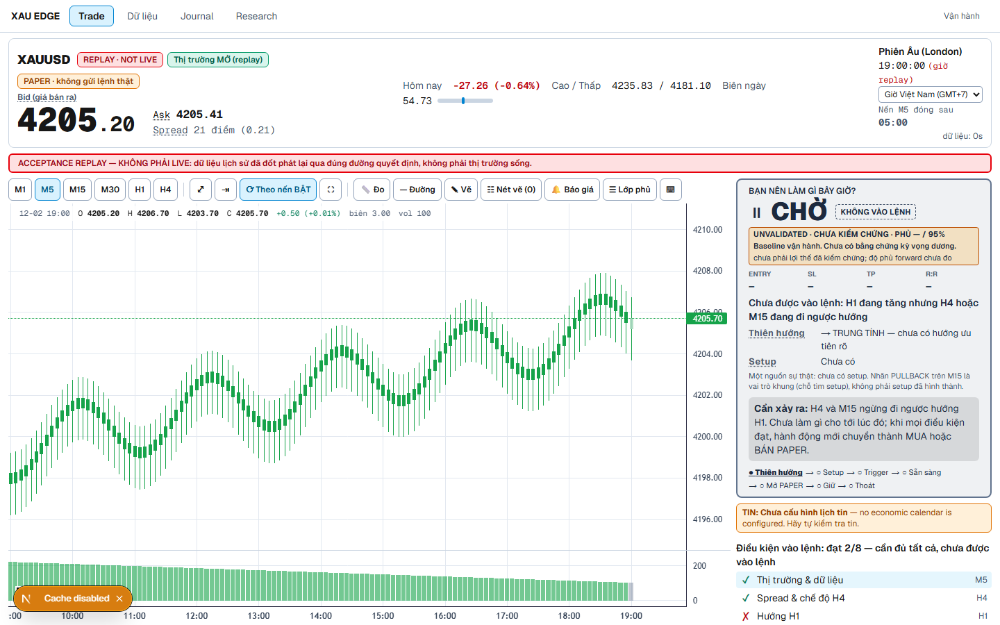
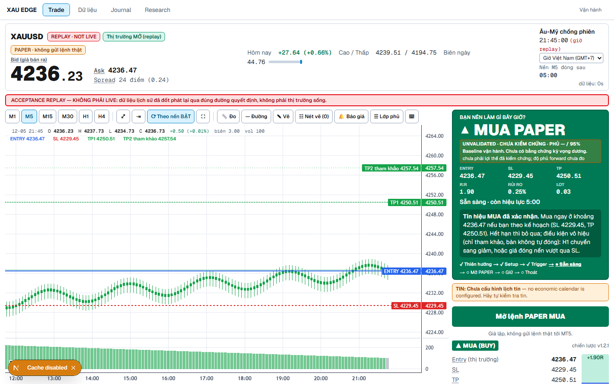
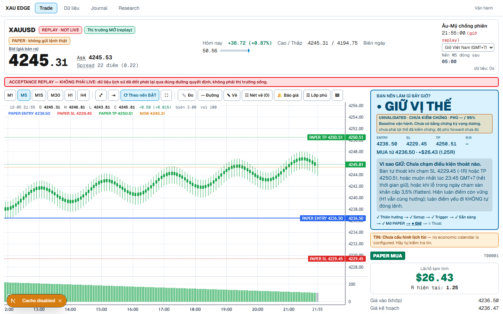
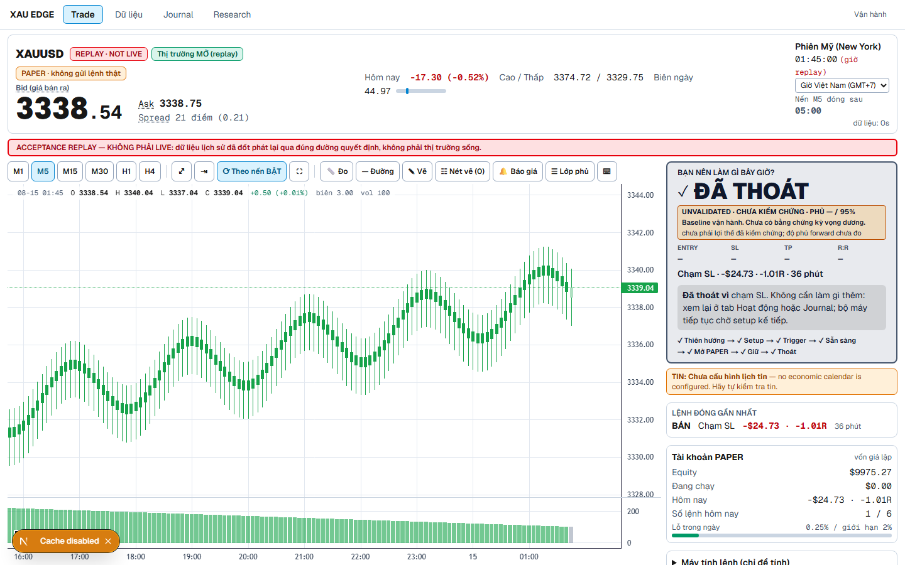

# XAU EDGE — Nền móng nghiên cứu V3 và hợp đồng quyết định cho người dùng

Ngày: 2026-10-11 (Chủ nhật, thị trường ĐÓNG). Phạm vi: chỉ PAPER. Không gửi lệnh MT5, không bật DEMO/FUNDED, không mở Test-H/Holdout, không chạy kết quả của giả thuyết mới nào.

Quy tắc của báo cáo: code và số đo thắng báo cáo cũ. Mỗi khẳng định có trích dẫn file:dòng, file số đo, hoặc mục báo cáo. Tín hiệu vận hành ≠ edge đã kiểm chứng.

---

## 1. Trạng thái đã xác minh

Baseline của `INDEPENDENT_EDGE_FAILURE_AUDIT.md` được kiểm lại nhanh, không làm lại:

| Khẳng định | Kiểm lại | Nguồn |
|---|---|---|
| Đường chuẩn: data/market → TradeEngine → TradingSignal v2 → ExecutionIntent → PaperDesk | đúng | ADR-0026; `trading/execution_intent.py` |
| Bàn PAPER chỉ có **một** TP | đúng | `paper_desk.py:518` (`"tp": decision.take_profit`) |
| Luận điểm yếu đi **không** đóng lệnh | đúng | `paper_desk.py:139-143` (`close_on_invalidation=False`) |
| BE/trailing tắt mặc định | đúng | `position_manager.py:56-66` |
| Thoát thật sự: SL, TP, hết giờ 120′, chính sách đóng cửa, KILL_SWITCH, DAILY_LOSS_GUARD (flatten 3,5%), EQUITY_FLOOR | đúng | `paper_desk.py`, `governor.py:30-33` |
| Evidence engine luôn `validated_edge=False` | đúng; nay thêm `level: "UNVALIDATED"` | `engine.py` `_evidence`, `EVIDENCE_LADDER` |
| V1 18 biến thể, V2 20 biến thể, 0 sống sót | đúng | `edge-program-v2/ledger.md`; ADR-0030 |
| Replay: 11 lệnh, WR 18%, mean −0,41R, PF 0,47 | không đổi | audit §replay |
| Forward: 0 setup, 0 lệnh paper | đúng (đo lại §6) | `/trade/decision` |

Kết luận: không có edge đã kiểm chứng. Sản phẩm là một **bàn quyết định PAPER trung thực** quanh một chiến lược baseline UNVALIDATED.

## 2. Sửa ngữ nghĩa UI (Phase A)

| Vấn đề (code trước) | Sửa | File |
|---|---|---|
| TP2 trông như mục tiêu được quản lý, nhưng bàn không chốt ở TP2 | Nhãn "TP 2 (tham khảo)", ghi chú `plan-tp2-note`; trên chart "TP2 tham khảo" nét chấm; modal "TP 2 (chỉ tham khảo, bàn không chốt ở đây)" | `DecisionPanel.tsx`, `TerminalChart.tsx`, `ConfirmModals.tsx` |
| Điều kiện vô hiệu trông như stop tự động | Ô `plan-invalidation` + ghi chú "chỉ tham khảo, bàn không tự đóng"; câu hành động MUA/BÁN nói rõ | `DecisionPanel.tsx`, `lib/action.ts` |
| Thanh nav đặt "System/Control" ngang hàng việc giao dịch | Nav: Trade, Dữ liệu, Journal, Research; "Vận hành" tách bên phải, có tooltip | `components/MainNav.tsx` |
| Chữ "LIVE" dễ hiểu là tiền thật | Đã có "PAPER · không gửi lệnh thật" và "REPLAY · NOT LIVE"; mức bằng chứng nay luôn hiện | `DecisionPanel.tsx` (HonestyBadge) |
| **CHỜ ghi sai "Chưa có hướng ưu tiên"** khi H1 có xu hướng nhưng lý do chặn đầu tiên không phải NO_SETUP/NO_TRIGGER (≈20% phút mở cửa: 48/234) | CHỜ nay nói lý do thật: "Chưa được vào lệnh: H1 đang tăng nhưng H4 hoặc M15 đang đi ngược hướng" + "Cần xảy ra: …" | `lib/action.ts` (nhánh WAIT cuối), `lib/vi.ts` (`WAIT_WHY_VI`, `waitWhy`) |

Lỗi CHỜ được xác nhận bằng DOM lúc chạy (trước: "Chưa có hướng ưu tiên · đang chờ: H4 và M15 ngừng đi ngược hướng H1"; sau: câu ở bảng trên). Đã gỡ instrumentation.

## 3. Hợp đồng quyết định cho người dùng

Mỗi trạng thái trả lời: HÀNH ĐỘNG, VÌ SAO, BẰNG CHỨNG, ENTRY, SL, TP, RR, RỦI RO, HẾT HẠN, VÔ HIỆU, ĐIỀU KIỆN TIẾP.

| Trạng thái | Hành động hiển thị | Vì sao | Mức giá | Rủi ro | Điều kiện tiếp |
|---|---|---|---|---|---|
| CHỜ | "CHỜ · KHÔNG VÀO LỆNH" | `waitWhy(code, h1)` cho **mọi** mã refusal (`WAIT_WHY_VI`) | "—" (không bịa mức) | — | "Cần xảy ra: …" từ `why_wait.next_condition` |
| MUA / BÁN | "▲ MUA PAPER" / "▼ BÁN PAPER" | setup + trigger đã xác nhận | ENTRY, SL, TP, R:R; TP2 tham khảo | `hero-risk` (%), `hero-lot` | hết hạn đếm ngược; vô hiệu (tham khảo) |
| GIỮ | "• GIỮ VỊ THẾ" | "Vì sao GIỮ: Chưa chạm điều kiện thoát nào." | entry khớp, SL, TP, R hiện tại | P&L tạm tính | "Cái gì buộc thoát": SL, TP, hết giờ, sàn lỗ ngày 3,5%; luận điểm yếu **không** tự đóng |
| THOÁT | "Đã thoát: …" | lý do cụ thể từ `EXIT_REASON_VI` (SL, TP, TIME_EXPIRY, DAILY_LOSS_GUARD, FORCED_FLAT, KILL_SWITCH, EQUITY_FLOOR, MANUAL_CLOSE, …) | giá thoát, R | — | quay về CHỜ |
| KHÔNG KHẢ DỤNG | "KHÔNG CÓ QUYẾT ĐỊNH" | stale / writer conflict / thị trường đóng | ẩn | — | điều kiện phục hồi |

Bằng chứng: mọi trạng thái hiện badge `data-level` theo thang ở §13; mức không rõ rơi về UNVALIDATED (`lib/honesty.ts`). Không có chữ "Strong Buy" hay mức tự tin nào ngoài thang.

Ảnh (fixture replay, **không phải bằng chứng live**):






## 4. Ma trận nghiệm thu UI

| Tiêu chí | Kiểm bằng | Kết quả |
|---|---|---|
| CHỜ có lý do thật cho TIMEFRAME_CONFLICT, TOO_CLOSE_TO_RESISTANCE, SPREAD, VOLUME khi H1 có xu hướng | `e2e/decision_contract.spec.ts` | PASS |
| MUA: TP2 tham khảo, vô hiệu tham khảo, rủi ro %, lot | `decision_contract.spec.ts` | PASS |
| GIỮ: vì sao giữ + điều buộc thoát (3,5%) | `decision_contract.spec.ts` | PASS |
| THOÁT: DAILY_LOSS_GUARD, FORCED_FLAT, KILL_SWITCH, MANUAL_CLOSE | `decision_contract.spec.ts` | PASS |
| Mức bằng chứng lạ → UNVALIDATED | `decision_contract.spec.ts` | PASS |
| Nav "Vận hành" tách khỏi link giao dịch | `decision_contract.spec.ts` | PASS |
| Không mất chiều cao chart trên điện thoại (≥280px) | `honesty`/`lifecycle` | PASS (copy bằng chứng ẩn trên phone) |
| Goldens khớp contract (`level`) | 19 golden tái sinh; `test_cockpit` | PASS |
| Unit trading | `pytest tests/unit/trading -m "not mt5"` | 276 passed |
| tsc / eslint | | sạch |
| Focus trap của modal paper | `terminal.spec.ts:216` | **FAIL có từ trước** (cũng fail trên code baseline dưới dev server sandbox); chưa sửa |
| Lifecycle thật quan sát trên LIVE (setup → lệnh → thoát) | forward | **CHƯA QUAN SÁT** (0 setup live) |

LIVE dashboard (cổng 3000) vẫn phục vụ bản `.next` cũ cho tới khi build lại và khởi động lại lúc thị trường ĐÓNG.

**Đóng băng sản phẩm** từ đây: UI chỉ nhận sửa lỗi, độ rõ của quyết định, đúng ngữ nghĩa, và hồi quy.

## 5. Mô hình chi phí v2

Số đo: `edge-program-v3/foundation/cost_model_v2.py` → `cost_model_v2.json`.

| Thành phần | Số đo | Trạng thái |
|---|---|---|
| Spread tick trung vị theo năm (điểm) | 2021: 11 · 2022: 17 · 2023: 17 · 2024: 20 · 2025: 26 · 2026: 46 (p90 2026: 62) | ĐO (tick từ 2021-10) |
| Theo phiên | Á 22 · London 20 · chồng phiên 20 · NY muộn 20 · rollover 25 | ĐO |
| Tick/nến cùng phút | 2021–23 trung vị 1,43–1,63 (p90 ≤ 2,43); 2024–26 1,03–1,10 (p90 1,15–1,70) | ĐO ⇒ hệ số 1,6/2,4 (2011–23), 1,1/1,7 (2024+) |
| Spread/ATR(H1) theo nến | Dev-2 0,07–0,13 (LOW 0,135 · MID 0,096 · HIGH 0,070); Val-2 0,02–0,05; 2022–26 0,017–0,033 | ĐO — chi phí ở Dev-2 nặng gấp 3–5 lần gần đây |
| Quanh tin (NFP proxy, 60 sự kiện) | phút 0–2: 31 vs 26 điểm ở thứ Sáu đối chứng; bình thường từ +3′ | ĐO |
| Trượt giá | giả định 3 (base) / 6 (bi quan) điểm | **CHƯA ĐO** (0 lệnh) |
| Commission | 0 | **CHƯA XÁC MINH** — mọi kết quả phải báo thêm commission hòa vốn |
| Swap XAU | long −69,25 (live) vs −76,05 (CostModel); short −4,2 | ĐO một lần; đọc lại trước khi chạy |

## 6. Độ phủ forward

| Chỉ số | Giá trị |
|---|---|
| Độ phủ phút mở cửa | **48,64%** (232/477) |
| Khoảng trống | 30′ và 215′ (2026-10-09 17:14–20:48 UTC): supervisor chết cùng console, exit 0x40010004 |
| Dòng trùng / trễ / xấp xỉ | 7 / 6 / 233 |
| Setup live / lệnh paper | 0 / 0 |
| Ngày đạt chuẩn (≥95%) | 0/15 |
| Mức | **F0** |

Đã chuyển stack sang Task Scheduler; supervisor khởi động lại ≈03:43 UTC hôm nay. Sớm nhất đạt 15 ngày liên tục ≥95%: ≈2026-10-30, nếu không có khoảng trống nào. Không backfill.

## 7. QA cross-asset

Nguồn: FTMO-Demo MT5, chỉ đọc (`foundation/cross_asset_probe.py`, `cross_asset_qa.py`, `cross_asset_manifest.json`).

| Kiểm | Kết quả |
|---|---|
| Có symbol | XAUUSD, EURUSD, USDJPY, XAGUSD |
| Độ dài | EURUSD/USDJPY: H1 từ 2002-10, M1 từ 2009-11 (6,249M nến); XAGUSD: H1 2008-11, M1 2009-12 (5,699M) |
| Căn phút với XAU M1 (2011+) | FX có mặt 99,7%; XAG 98,8% |
| Khoảng trống | FX: ~113 > 15′, ~22 > 60′; XAU/XAG ~3,875 > 60′ = nghỉ hằng ngày |
| DST/UTC | mở tuần CN 21/22 UTC, đóng T6 ≈20 UTC, giống nhau ở mọi symbol |
| Bất thường | cột spread: EURUSD 2020–21 trung vị 50; USDJPY 2021 50; XAU H1 2021 = 0 — không ảnh hưởng F1 (FX chỉ là yếu tố) |
| Manifest | 1,405 file, SHA-256 |

Kết luận: **PASS có cờ**. Chặn dữ liệu của F1 đã gỡ.

## 8. QA tin tức

`data/news/calendar.csv` chỉ phủ một tuần (ForexFactory hằng tuần, có `available_at`). **Không có lịch tin lịch sử ⇒ QA tin: BLOCKED.** Trường bắt buộc và quy tắc PIT đã đóng băng trong `F2_us_macro_reaction.md`. Chủ dự án chọn nguồn: lịch phát hành chính thức BLS/BEA/Fed/ISM (đề xuất) hoặc lưu trữ ForexFactory.

## 9. Đăng ký trước F1

`edge-program-v3/F1_gold_usd_residual.md` — biến thể `F1-USDRES-z2.0`. Residual của return XAU H1 sau khi hồi quy cuốn chiếu 500 nến lên u = ½(r_USDJPY − r_EURUSD); |z| ≥ 2,0 ⇒ vào ngược dấu ở open H1 kế tiếp; SL 1 ATR(H1), TP 2 ATR, timeout 24 H1, barrier trên M1, SL trước. ~250/năm. Dev ≥ 1,000, Val ≥ 400.

## 10. Đăng ký trước F3

`edge-program-v3/F3_us_session_momentum.md` — biến thể `F3-USMOM-0930-1400-1500-1645`. Hướng = dấu return 09:30→14:00 NY; vào 15:00 NY, thoát 16:45 NY; stop thảm họa 3 ATR(H1). ~250/năm. Rủi ro lớn nhất: chi phí ở Dev-2 (§5).

## 11. Đăng ký trước F2

`edge-program-v3/F2_us_macro_reaction.md` — biến thể `F2-MACRO-SETB-15-120`, **HOÃN**: ~108 sự kiện/năm < 150 (ECONOMICALLY IMPRACTICAL), forward 3,3–5,5 năm, và lịch tin lịch sử chưa có.

## 12. Ngân sách K

| Hạng mục | Giá trị | Nguồn |
|---|---|---|
| Programme 1 | 21 | `edge-program-v3/ledger.md` (theo ledger Programme 1) |
| V2 | 20 dùng / trần 24 (ledger thắng `STATE.json` ghi 48) | ADR-0030 |
| V3 | **K_V3 = 3** (F1, F3, F2); còn 1 khe, không dùng nếu không có chữ ký chủ dự án | `edge-program-v3/ledger.md` |
| K_tổng cho Test-H/Holdout | 21 + 20 + 3 = **44** ⇒ α = 0,05/44 | `COMMON_PROTOCOL.md` |
| Stage 1 / Val | α = 0,10/3 / 0,05/3 | `COMMON_PROTOCOL.md` |

Không mở rộng K. Mỗi biến thể là một giá trị tham số; không quét.

## 13. Thang kiểm chứng

| Bậc | Điều kiện | Câu UI |
|---|---|---|
| UNVALIDATED | mặc định | "Baseline vận hành. Chưa có bằng chứng kỳ vọng dương." |
| DEVELOPMENT CANDIDATE | Stage 1 Dev PASS | chỉ ở Research |
| VALIDATED CANDIDATE | + Val PASS + review độc lập | chỉ ở Research |
| OOS VALIDATED | + Test-H PASS (một lần, α = 0,05/44) | |
| HOLDOUT VALIDATED | + Holdout PASS (một lần) | |
| FORWARD PAPER VALIDATED | + forward F2-level, ≥15 ngày ≥95% phủ, đủ mẫu | |
| DEMO CANDIDATE | + chữ ký chủ dự án | DEMO vẫn tắt cho tới quyết định riêng |

Định nghĩa: `lib/honesty.ts` (`EVIDENCE_LADDER`), `engine.py` (`EVIDENCE_LADDER`). Engine hiện phát `UNVALIDATED`; nâng bậc cần ADR có chữ ký, không tự động.

## 14. Tần suất và power

`foundation/power_v3.json` (một phía, power 0,8, σ = 1,0–1,3R):

| Họ | Sự kiện/năm | MDE Dev | MDE Val | MDE Test-H | MDE Holdout | Forward cho +0,15R |
|---|---|---|---|---|---|---|
| F1 | ~250 | 0,06–0,078 | 0,108–0,141 | 0,135–0,175 | 0,29–0,37 | 1,57–2,65 năm |
| F3 | ~250 | như F1 | | | | |
| F2 tập B | ~120 | | | 0,195–0,253 | | 3,3–5,5 năm — **< 150/năm** |
| F2 tập A | ~32 | | | | | 12–21 năm — **không khả thi** |

Kinh tế ở +0,15R: rủi ro 0,25% × 250/năm ≈ 9,4%/năm; 0,5% ≈ 18,75%/năm (trước tương quan và drawdown). Holdout chỉ phát hiện được hiệu ứng ≥ 0,29R ⇒ chỉ là kiểm tra hướng, không phải bằng chứng độ lớn.

## 15. Lộ trình 30/60/90 ngày

- **30 ngày**: forward chạy không gián đoạn tới ≥15 ngày ≥95% (≈2026-10-30); F1 Stage 1 trên Dev-2 (cổng ở `COMMON_PROTOCOL.md`); rebuild + restart LIVE dashboard lúc thị trường ĐÓNG; chủ dự án chọn nguồn lịch tin.
- **60 ngày**: nếu F1 Dev PASS → review độc lập → F1 Val một lần. F3 Stage 1 trên Dev-2. Đo trượt giá thật từ lệnh paper (nếu có).
- **90 ngày**: ứng viên đã Val PASS + review → Test-H một lần. Nếu cả F1 và F3 rớt Dev: dừng V3, viết báo cáo âm tính, không mở biến thể mới khi chưa có ADR.

## 16. Năm việc ưu tiên

1. Giữ forward không gián đoạn (Task Scheduler) và báo cáo độ phủ mỗi ngày.
2. Chạy F1 Stage 1 trên Dev-2 đúng như đăng ký — chỉ sau khi commit đăng ký này.
3. Build lại và khởi động lại LIVE dashboard lúc thị trường ĐÓNG để người dùng thấy hợp đồng quyết định mới.
4. Chủ dự án chọn nguồn lịch tin lịch sử (F2 vẫn hoãn vì tần suất).
5. Xác minh commission thật của tài khoản (hiện 0, CHƯA XÁC MINH).

## 17. Ngừng làm

- Tối ưu để phát nhiều MUA/BÁN hơn.
- Tinh chỉnh v1.1 bằng hindsight; quét tham số; thêm biến thể ngoài K.
- Thêm BE/trailing/chốt một phần trước khi một entry qua Validation.
- Thêm tính năng UI ngoài phạm vi đóng băng.
- Gọi bất kỳ thứ gì là "edge" khi chưa qua thang §13.
- Viết báo cáo mới thay cho số đo.

## 18. Ma trận sẵn sàng

| Hạng mục | Trạng thái |
|---|---|
| Hợp đồng quyết định trên UI (fixture) | XONG |
| Hợp đồng quyết định quan sát trên LIVE | CHƯA (0 setup live; LIVE chạy build cũ) |
| Mô hình chi phí v2 | XONG, trừ trượt giá và commission |
| Độ phủ forward | F0 (48,64%) |
| Cross-asset | PASS có cờ |
| Lịch tin lịch sử | BLOCKED |
| Đăng ký trước F1/F3/F2 | XONG (F2 hoãn) |
| Kết quả F1/F3 | CHƯA CHẠY |
| Quản lý vị thế (BE/trail/partial) | không làm cho tới khi có entry qua Val |
| DEMO/FUNDED | TẮT |

---

## FINAL VERDICT

```
HUMAN DECISION UI:            PARTIAL — hợp đồng đầy đủ trên fixture; lifecycle thật chưa quan sát trên LIVE, forward F0
BUY/SELL VISIBILITY:          COMPLETE trên fixture (entry, SL, TP, R:R, rủi ro, lot, hết hạn, vô hiệu) — chưa quan sát live
HOLD/EXIT VISIBILITY:         COMPLETE trên fixture (vì sao giữ, điều buộc thoát, lý do thoát cụ thể) — chưa quan sát live
POSITION MANAGEMENT EVIDENCE: UNVALIDATED — một TP, không BE/trail, không có lệnh nào để đo
FORWARD EVIDENCE:             F0 — 48,64% phủ, 0/15 ngày đạt, 0 setup, 0 lệnh
CURRENT EDGE:                 NONE
NEXT RESEARCH FAMILY:         F1 (phần riêng của vàng sau khi loại USD), rồi F3; F2 hoãn
REAL-MONEY SUPPORT:           NO
```
